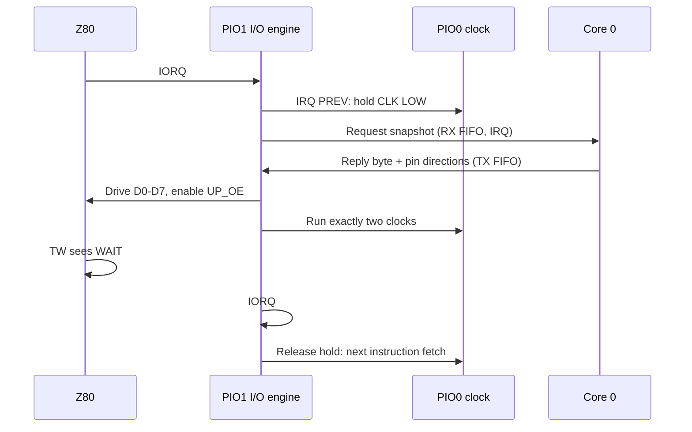

# D.3 Z80 I/O with the PIO Engine

The Z80 executes CP/M directly from SRAM; only `IN` and `OUT` instructions
reach the Pico. In Phases 9 and 10 every one of those I/O cycles is completed
by the RP2350's PIO hardware. Core 0 never touches the bus during a cycle: it
only applies a written byte or supplies a byte to read. This page explains the
terms, what each PIO block does, and why this makes Z80 I/O fast.

## PIO terminology

| Term | Meaning |
| --- | --- |
| PIO block | A programmable I/O peripheral. The RP2350 has three: PIO0, PIO1 and PIO2. Each has 32 words of instruction memory shared by its state machines. |
| State machine (SM) | A tiny independent processor inside a block (four per block). It executes one PIO instruction per system clock: 8.33 ns at the 120 MHz supervisor clock, so its timing is exact and repeatable. |
| Scratch and shift registers | Each SM has X and Y scratch registers, an output shift register (OSR) for data going to pins, and an input shift register (ISR) for data read from pins. |
| Pin mappings | Each SM is configured with windows of GPIOs: `IN` reads from them, `OUT` and `SET` drive them, *side-set* drives a pin in the same instruction as other work, and `JMP PIN` branches on one pin. |
| FIFOs | Two four-word queues per SM. The SM *pushes* to the RX FIFO for the ARM cores to read; the ARM cores put words in the TX FIFO for the SM to *pull*. *Autopush* pushes the ISR automatically when it is full. |
| IRQ flags | Eight flags per block that SMs set, clear and wait on. They can interrupt an ARM core, and on the RP2350 `IRQ PREV` sets a flag in the neighbouring (previous) block. |

## The role of each PIO block

| Block | Program | Role |
| --- | --- | --- |
| PIO0 | `banked_clock`, 4 words | Generates the 20 MHz Z80 clock (3 ticks HIGH, 3 LOW) on GP2. It stops in a LOW phase whenever PIO0 IRQ flag 1 (I/O hold) or flag 2 (core-0 hold) is set. It shares PIO0 with the matrix display's I²C program. |
| PIO1 | `banked_io`, 29 words | The I/O engine. Claimed exclusively; it recognises, completes and times every Z80 `IN` and `OUT`, and drives the data bus, buffer enables, WAIT release and SRAM bank select (A16). |
| PIO2 | (not used by the Z80) | Left for the CYW43 Wi-Fi driver, whose SPI bus claims the highest free PIO block. |

PIO1's engine holds the Z80 clock through PIO0 with `IRQ PREV`, so the clock
and the I/O engine cooperate without any ARM involvement.

### PIO1 pin windows

| Mapping | GPIOs | Signals |
| --- | --- | --- |
| `IN` | GP10 upwards | D0-D7, A0/A1/A2/A4, RD#, WR# |
| `OUT` (10 pins) | GP8-GP17 | A16 bank select, IO_RELEASE, D0-D7 |
| `SET` (2 pins) | GP6-GP7 | UP_OE# (Pico drives the Z80 bus), DOWN_OE# (Pico reads the Z80 bus) |
| Side-set | GP9 | IO_RELEASE: releases the hardware WAIT# |
| `JMP PIN` | GP27 | RD#: distinguishes `IN` from `OUT` |

The HCT32 asserts WAIT# in hardware as soon as IORQ# falls, so the Z80 is
already waiting before PIO sees the cycle.

## How PIO data reaches core 0

The I/O engine exchanges one 32-bit word per cycle with core 0 through its
FIFOs:

| Direction | Instruction | Word contents |
| --- | --- | --- |
| PIO1 → core 0 (RX) | `in pins, 32` with autopush | A snapshot of the pins: data in bits 0-7, A0/A1/A2/A4 in bits 8-11, RD# in bit 17, WR# in bit 18 |
| Core 0 → PIO1 (TX) | `pull`, `out pins, 10`, `out pindirs, 10` | The reply for an `IN`: pin levels for GP8-GP17 (A16 unchanged, IO_RELEASE LOW, D0-D7) in bits 0-9, then the pin directions to use while driving (bits 10-19) and when idle (bits 20-29) |

An RX-not-empty interrupt runs core 0's handler, which takes snapshots in bus
order: each OUT becomes a device write and each IN a device read whose byte
goes back in the TX FIFO (see [Division of work](#division-of-work)). The
handler and the device code it calls run from SRAM.

## An OUT cycle

1. IORQ# falls; PIO sets the I/O hold so the clock stops at its next LOW
   phase, and `JMP PIN` sees RD# HIGH.
2. PIO enables the receive buffer (DOWN_OE#) and lets it settle for eight
   ticks.
3. For port `07h` it drives D0 onto A16, switching the SRAM bank. For any
   other port it autopushes the snapshot to core 0.
4. It releases WAIT# while CLK is still LOW, clears the hold so the clock runs
   freely, waits for IORQ# to rise, then isolates the buffer and rearms WAIT#.

The Z80 continues as soon as PIO completes the cycle; core 0 applies the write
afterwards. If four writes are already queued, PIO waits before releasing
WAIT#, so the Z80 simply pauses rather than losing data.

## An IN cycle

After the reply arrives, PIO places the byte on D0-D7, enables the buffer
toward the Z80 and releases WAIT#. It then lets the clock run exactly two
cycles: in the first the Z80 sees WAIT# released, and at the falling edge of
the second (T3) it samples the data. PIO re-asserts the hold at precisely the
right instruction, so the clock stops in T3's LOW phase. Only after the bus is
isolated does the clock resume into the next opcode fetch, so the Pico can
never still be driving the bus when the Z80 reads its next instruction.

## Division of work

| Owner | Responsibility |
| --- | --- |
| PIO0 + PIO1 | All Z80 bus timing: the 20 MHz clock, cycle detection, buffer enables, data drive and sampling, WAIT# release and A16 bank select |
| Core 0 | The Z80's supervisor and the device logic behind its I/O ports |
| Core 1 | USB, Wi-Fi and network services, the web terminal, flash programming and the disk read-ahead |

### Core 0: PIO1 interrupt

The RX-not-empty interrupt is core 0's only per-cycle work. It takes each
snapshot in bus order, applies OUT bytes and computes IN replies:

| Ports | Work |
| --- | --- |
| `00h-01h` console | Queue output to the shared ring for core 1 (USB or WebSocket), return input bytes, report status without taking the lock |
| `10h-14h` disk | Latch drive and LBA, run commands, serve reads from the SRAM read-ahead or flash, collect 128-byte write records and hand them to core 1 |
| `02h-04h` service ABI | Collect requests for core-1 workers and return their replies |
| `17h` timers | Countdown timers and stopwatches |
| `15h-16h` HTTP | Filename and chunk handshakes with the core-1 HTTP worker |
| `05h`, `06h` | Boot markers and disk-diagnostic results |
| `07h` (IN) | SRAM bank status; `OUT 07h` completes entirely in PIO |

Measured cost is about 1 µs per IN and 1.2-1.3 µs per OUT. Even at about
266,000 polled INs per second this is roughly a quarter of core 0's time
(excluding interrupt entry and exit), and most of it answers console-status
polls. Anything slow is handed to core 1 through bounded queues and
mailboxes.

### Core 0: main loop

- **Flash grants.** When core 1 must program flash, core 0 parks the Z80 with
  BUSREQ#, applies queued OUTs and pauses the I/O engine. Afterwards it rearms
  the engine and returns the bus.
- **Watchdog.** A cycle that makes no progress for 500 ms holds the CPU in
  reset.
- **Supervisor commands** from core 1 (the **Ctrl-]** menu): load and verify,
  start, status (`[pio]`, `[iolat]`, `[disk]`), stop, reboot, fault arming,
  and configuration or web reboots.
- **Run monitoring.** BIOS and CCP boot markers, the boot timeout,
  disk-diagnostic progress, and holding the CPU on a fatal storage error.
- **Orderly stop.** Request a flush from core 1, park the Z80, apply queued
  OUTs and check disk quiescence, then hold RESET# or resume.
- **State publication** for core 1.

### Core 0: boot

Before CP/M starts, core 0 recovers the flash journal, validates the boot
image and loads all 64 KiB into SRAM by injecting instructions on a slow,
software-stepped clock, then reads every byte back. It prepares bank 1 and
only then arms the I/O engine and starts the 20 MHz PIO clock. This loader is
the only use of stepped clocking.

Core 0 does no bus timing, clock stopping or stepping during a cycle, and no
USB, network or flash programming. Between cycles it is idle in its main
loop.

## Why it is fast

- **Hardware timing.** Every bus step is a PIO instruction with 8.33 ns
  resolution. There are no software delays, timer polls or clock stepping in
  the I/O path.
- **Core 0 does only the data work.** About 1 µs per IN in the measured
  workload, and an OUT never makes the Z80 wait for core 0 unless four writes
  are already queued.
- **High throughput.** Polled IN cycles run at about 225,000-266,000 per
  second on the 20 MHz Z80, which directly speeds up console polling, every
  `INIR` disk record transfer, and service and HTTP replies.
- **Bank switching at bus speed.** `OUT 07h` never involves an ARM core.
- **Isolated from Wi-Fi.** The handler runs from SRAM and does no network or
  flash work, so core-1 activity cannot stretch a Z80 I/O cycle.
- **Ordered and backpressured.** One FIFO preserves the Z80's bus order: an
  IN always observes every earlier OUT. A full FIFO holds WAIT# instead of
  dropping data.

**Ctrl-] s** reports the engine state (`[pio]`), core-0 cost per IN and OUT
(`[iolat]`) and disk read-ahead hits (`[disk]`).

## Safety

- Snapshots with neither or both of RD# and WR# active hold the CPU in reset
  through the watchdog.
- A cycle that makes no progress for 500 ms fails closed the same way.
- During a flash bus grant the board's pull-ups keep IORQ#, RD# and WR#
  inactive, and core 0 drains the FIFO before the grant and before a
  supervisor stop.

Source: [banked_io.pio](https://github.com/gloveboxes/Z80ROMlessSBC/blob/main/src/common/banked_io.pio)
(both PIO programs), [banked_pio.c](https://github.com/gloveboxes/Z80ROMlessSBC/blob/main/src/common/banked_pio.c)
(allocation, FIFO service) and [io_trap.c](https://github.com/gloveboxes/Z80ROMlessSBC/blob/main/src/common/io_trap.c)
(device dispatch). Hardware details: [PIO acceleration](../hardware/address-interface.md#pio-acceleration).
