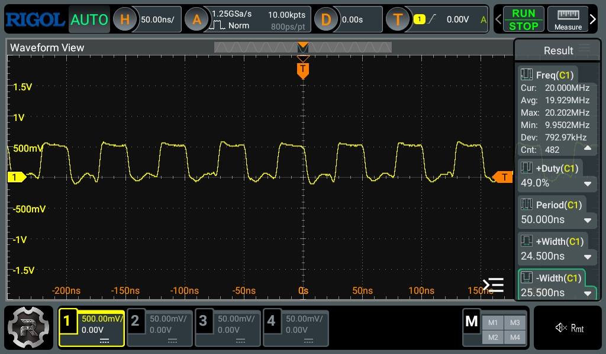

# RIGOL DHO814 Capture Plan

An oscilloscope is optional for building the board. Use one to investigate
signal quality and measure electrical timing margins.

## What to measure

- Use the scope for voltage, pulse widths, edge shape, ringing, and timing at
  receiving pins. Use [DSLogic](logic-analyzer.md) for whole-bus ordering.
- The horizontal axis is time; the vertical axis is voltage relative to GND.
  Trigger levels align captures; they are not logic pass thresholds.
- Arm Single before issuing a test command. If it keeps waiting, check source,
  edge, level, and whether the stimulus ran.

## Probe and instrument preparation

1. Bond the DHO814 chassis to protective earth with its supplied ground cable
   before connecting probes. USB-C power does not earth it. Probe grounds/BNC
   shells are common: connect them only to circuit GND, never a signal or rail.
2. Power down before attaching or moving probes: disconnect USB before +5 V;
   restore +5 V before USB. Stopping acquisition does not remove circuit power.
3. Set each probe and channel to **10X**. Compensate each probe on the scope’s
   calibration output. Prefer ground springs; keep wire grounds under 20 mm.
4. Set active channels to **1 MOhm, DC coupling, Invert OFF, Delay 0,
   bandwidth limit OFF**. Use full 100 MHz bandwidth for edge/timing evidence.
5. Use **Normal acquisition**, not Average. Use Normal trigger sweep for
   repetition or Single for one-off events; Auto sweep is not pass evidence.
6. Start at **1 V/div** for 3.3 V nodes or **2 V/div** for 5 V. Keep GND and both
   levels visible. Trigger on CH1 at approximately 1.65 V or 2.5 V respectively.
7. Use Auto memory for repetitive clocks; for single shots select the largest
   depth available. Disable unused channels for better sample rate:

   | Active channels | Maximum depth | Maximum sample rate |
   | --- | --- | --- |
   | 1 | 25 Mpts | 1.25 GSa/s |
   | 2 | 10 Mpts | 625 MSa/s |
   | 3–4 | 5 Mpts | 312.5 MSa/s |

8. Place the trigger around 40% across the screen. Measure frequency, period,
   duty, HIGH/LOW widths, extrema, rise/fall, and relevant inter-channel delays.
   Confirm automatic readings with cursors and visible edges.
9. Save screenshots **and waveforms**, recording firmware identity, phase,
   stimulus, clock rate, probe points/ratios, bandwidth, sample rate, memory
   depth, rail voltages, and measured minima/maxima.

Settings follow the [RIGOL DHO800 User Guide](https://www.rigol.com/dam/global/downloads/brochures/en/user-manual/oscilloscopes/DHO800_UserGuide_EN.pdf).
For supply noise, a separately labelled bandwidth-limited capture may supplement
full-bandwidth evidence.

## 20 MHz no-I/O clock measurement

Use the [Phase 6 no-I/O scope diagnostic](../implementation/20mhz-scope.md).
Unlike the reporting screens/soaks, it does not pause CLK for I/O reports.

1. Deploy **Flash Pico - Phase 6 20 MHz scope diagnostic**.
2. Prepare/earth the scope as above. With board power off, connect CH1 to
   **Z80 CLK pin 6**, ground spring to nearby common GND. U4 pin 18 is an
   accessible buffered-output alternative; GP2/header 4 measures only the
   3.3 V source before U4.
3. Enable CH1 only: **10X, DC, 1 MOhm, full bandwidth, 2 V/div, 20 ns/div**,
   Normal acquisition, Auto depth. Trigger CH1 rising at approximately 2.5 V.
4. Restore +5 V, then USB. Send **`f` + Enter** and wait for **RUN**; exclude
   the slow load/verify/reset interval from measurements.
5. Measure frequency, period, duty, and HIGH/LOW widths. At 20 MHz the period
   is 50 ns. Inspect adjacent edges, levels, ringing, and missing pulses.
6. Save waveform/screenshot and metadata. Repeat at GP2 and U4 pin 18 if
   comparing source, buffer, and interconnect; power down before moving probes.
7. Send **`x`** to stop and read the SRAM mailbox. Exclude this slow readback
   from the capture interval. A mismatch HALTs Z80 code but leaves PWM running,
   so a clock alone does not prove the test is progressing.

### Recorded project capture



- Cursor frequency/period: **20.0000 MHz / 50.000 ns**.
- Duty/HIGH/LOW: **49% / 24.5 ns / 25.5 ns**.
- Across 482 counter readings: average **19.929 MHz**, range **9.9502–20.202 MHz**.
- The low counter reading needs waveform review before claiming missing-edge
  or jitter qualification. Frequency alone does not qualify receiving-pin
  voltage or signal integrity.

## Four-channel connections and expected results

Connect the channels exactly as listed, using the physical IC pin as the
probe point. CH1 is the normal trigger source unless the row explicitly names
another source. Where a row lists alternatives, repeat the capture for every
alternative while leaving the other channels in place where possible.

| Purpose | CH1 / trigger | CH2 | CH3 | CH4 | Trigger and expected outcome |
| --- | --- | --- | --- | --- | --- |
| Clock translation | Pico GP2, header pin 4 | AHCT244 pin 18 | Z80 CLK pin 6 | Z80 RESET# pin 26 | CH1 rising. At 1 kHz, 100 kHz, 1 MHz, and each qualification rate, CH1 is about 0-3.3 V and CH2/CH3 about 0-5 V. CH2 and CH3 match frequency and duty cycle, contain no extra edges, and differ only by interconnect delay. RESET# stays HIGH while running. |
| Reset sequence | Z80 RESET# pin 26 | Z80 CLK pin 6 | Z80 M1# pin 27 | Z80 MREQ# pin 19 | CH1 rising, Single. RESET# remains LOW for at least three complete clocks. After release, M1# and MREQ# produce valid active-LOW opcode-fetch activity with no runt RESET# or CLK pulse. |
| Flash quiescence | Z80 BUSREQ# pin 25 | Z80 BUSACK# pin 23 | Z80 RESET# pin 26 | Z80 CLK pin 6 | CH1 falling, Single. BUSACK# subsequently falls for flash erase/program, not memory DMA. Pico data paths remain isolated. Trap is rearmed before release; clocks contain no runt edges. |
| SRAM write control | Z80 CLK pin 6 | Z80 MREQ# pin 19 | Z80 WR# pin 22 | SRAM WE# pin 29 | CH1 rising. During CPU writes, including injected LD (HL),n, SRAM WE# follows WR# through AHCT244. WE# has no extra pulse and its LOW width is at least 45 ns. |
| SRAM read timing | Z80 CLK pin 6 | Z80 MREQ# pin 19 | SRAM OE# pin 24 | One SRAM data pin D0-D7: pins 13-15, 17-21 | CH1 rising. Repeat CH4 for all eight bits and the 00/FF/55/AA patterns. MREQ# and OE# assert LOW once per read; CH4 reaches the expected 0 V or 5 V state and is stable before the Z80 sampling edge. Use the DSLogic Group B capture to prove the complete byte and digital ordering. |
| Address integrity | Z80 CLK pin 6 | SRAM A0 pin 12 or A7 pin 5 | SRAM A8 pin 27 | SRAM A15 pin 31 | CH1 rising. Repeat with A0 and A7 on CH2 at 1, 2, 3, and 4 MHz, then at every [frequency-qualification rate](../implementation/frequency-qualification.md). For 0000/FFFF/5555/AAAA and walking patterns, each observed line matches the commanded bit, reaches valid 0/5 V levels, is stable during the active memory control interval, and has no double edge or excessive ringing. The DSLogic Group A capture proves A0-A15 together. |
| Boot-read inhibit | BOOT_READ_DISABLE at GP5, header pin 7 | Buffered RD# at AHCT244 pin 7 | SRAM OE# pin 24 | Z80 CLK pin 6 | CH1 edge, Single. Inhibit HIGH keeps OE# HIGH throughout injected instruction reads. Lower it only with Pico output isolated for intentional SRAM reads or normal execution. Repeat CH1 at AHCT244 pin 14. No unintended OE pulse is permitted. |
| Data-path exclusion | GP6 up-OE request, header pin 9 | GP7 down-OE, header pin 10 | AHCT245 OE# pin 19 | LVC245 OE# pin 19 | CH1 edge, Single; repeat CH2 edge and RD# at pin 21. Both OEs default HIGH. Up OE is GP6 OR RD#; down OE follows GP7. Both actual OEs must never be LOW together. This is a firmware rule with RD qualification, not an all-state hardware interlock; do not force both requests LOW. |
| I/O trap and WAIT# | Z80 IORQ# pin 20 | Z80 WAIT# pin 24 | Z80 CLK pin 6 | IO_RELEASE at GP9, header pin 12 | CH1 falling, Single. HCT32 asserts WAIT before the sampling edge. GP9 rises only after the data path is ready. Slow clocks complete I/O, then isolate/rearm before the execution clock resumes. WAIT must not reassert while IORQ/strobe remain active. Repeat CH4 at RD#, WR#, and both actual OEs. |
| Supply integrity | +5 V logic-rail entry at the 100 uF bulk capacitor | Farthest-board +5 V rail | Pico 3V3 header pin 36 | Z80 CLK pin 6 | Trigger on CH4 rising for repetitive operation; use Single on commands. Repeat at idle, injected RAM patterns, Z80 memory loop, disk write, and Wi-Fi traffic. CH1/CH2 remain 4.75-5.25 V; CH3 meets the Pico rail specification. No capture may show more than 250 mV droop or reset/clock disturbance. Keep DC-coupled full-bandwidth pass evidence. |

### Accept or investigate

- Compare LOW/HIGH levels and setup/hold times with the **receiving device’s**
  datasheet limits, not the trigger voltage.
- Investigate rail overshoot/undershoot, multiple threshold crossings, runt
  pulses, and ringing. Probe loading/ground leads can introduce artifacts.
- Rise/fall readings near 4.2 ns approach the combined 100 MHz scope/150 MHz
  probe response; do not interpret them as exact device edge times.
- Keep DSLogic whole-bus captures for final digital/frequency qualification.

## MCP Acceptance Runner

`scripts/scope-acceptance.mjs` collects Phase 2/8 evidence; it does not flash
or certify the board. Reports remain `qualified=false` until manual gates
pass. Its single-pause evaluator cannot qualify stepped I/O completion:
review raw clocks, data enables, and WAIT rearming manually.

### Preparation

1. Build the correct cumulative firmware and pass preceding phases. Phase 2 uses the empty Z80 socket; Phase 8 requires the assisted-loader board at the 1 MHz baseline.
2. Power off before changing probes. Use compensated 10X probes, full bandwidth, DC coupling, 1 MOhm inputs, verified deskew and common circuit ground. Scope ground clips are not floating inputs.
3. Install Node.js 20 or later and run `npm ci`. Build the current [rigol-mcp image](https://github.com/gloveboxes/rigol-mcp) in the selected runtime and initialize its capture volume using that project's instructions.
4. Stop the registered Rigol MCP server yourself and close the Pico serial terminal. The runner starts one dedicated server and calls it sequentially. `--exclusive-session` is your acknowledgement, not automatic proof that no other client is connected.
5. Use a new output directory under `build/bench/`. The runner checks firmware identity and scope readbacks before collecting evidence, and asks for board/probe/datasheet provenance.

### Phase 2 Clock Translation

Connect CH1 to Pico GP2 (3.3 V), CH2 to Z80 socket CLK pin 6 (5 V), and CH3 to the Z80 VCC supply node. Repeat a separate capture on AHCT244 pin 18 to distinguish buffer delay from interconnect delay. Keep the Phase 2 reset state; do not release a CPU merely to obtain a clock measurement.

```sh
mkdir -p build/bench
npm run scope:acceptance -- --mode stage2 --runtime container \
   --ip 192.168.1.43 --port /dev/cu.usbmodemYOUR_DEVICE \
   --output build/bench/stage2-first --exclusive-session --bench-confirmed
```

- Use `--runtime docker` for Docker.
- The runner checks calculated frequency within 1%, duty 45–55%, supply
  4.75–5.25 V, and settled clock HIGH against measured VCC minus 0.5 V.
- Missing/sentinel readings are inconclusive. The frequency tolerance checks
  gross errors, not oscillator accuracy or jitter.
- Inspect extrema, threshold crossings, and first/last pulses manually.
  Firmware DONE means the stimulus completed, not that the waveform passed.

### Phase 8 Clock Stop and Resume

Connect CH1=Z80 IORQ# pin 20, CH2=WAIT# pin 24, CH3=CLK pin 6, CH4=Pico IO_RELEASE GP9 (header pin 12). Thresholds are 2.5 V on the 5 V side and 1.65 V on the Pico side. Verify actual rails separately. Set these variables using the CPU datasheet and approved latency/pause budget; the runner has no guessed limits:

```sh
npm run scope:acceptance -- --mode stage8 --runtime container \
   --ip 192.168.1.43 --port /dev/cu.usbmodemYOUR_DEVICE \
   --output build/bench/stage8-first \
   --minimum-high-ns "$MIN_CLK_HIGH_NS" --minimum-low-ns "$MIN_CLK_LOW_NS" \
   --maximum-last-edge-us "$MAX_LAST_EDGE_US" --maximum-pause-us "$MAX_PAUSE_US" \
   --duration 60 --captures 3 --exclusive-session --bench-confirmed
```

- The runner starts the RAM/USB checker, captures events, checks fault counters,
  and holds reset on exit. `--duration 60` is not a one-hour pass; use 3600 and
  observe the firmware’s one-hour PASS for a full run.
- Exercise USB traffic separately. Wi-Fi/storage workloads require later-phase
  evidence; discrete captures cannot exclude faults between records.
- Retain inconclusive results for stepped completion. Check every completion
  clock, data setup/hold, both OEs HIGH, and GP9 LOW before execution resumes.
- Repeat CH4 at RD#, WR#, GP6/GP7, and actual OEs; retain DSLogic groups A–D.
- Last-edge delay includes clock-phase uncertainty; it is not exact ISR latency.
  Exclude deliberate pauses from jitter statistics. The 500 ms watchdog deadline
  is not a CPU timing limit.

### Reports and Restoration

1. Retain reports, `serial.log`, raw captures, and saved setup. Record source
   revision, flashed firmware identity, settings, thresholds, counters, and
   sample metadata; the current checkout does not identify the flashed UF2.
2. After the workload stops, choose whether to restore the saved scope setup.
   Check readback and the final SCPI error queue. Declined/failed restoration
   produces a nonzero exit and does not restart the previous workload.
3. If interrupted, hold reset or power down and inspect state before retrying.
   Restart the registered MCP server only after the dedicated runner exits.

### Fault Injection

Run host simulation first:

```sh
npm run test:control
npm run test:scope
```

Host tests check production control/loader/trap behavior against models;
they do not qualify electrical faults or real timing.

| Fault | Required observed behavior |
| --- | --- |
| BUSACK never asserts | Request timeout, BUSREQ HIGH, Pico data isolated, no flash programming. The request-timeout path leaves the CPU running. |
| BUSACK stuck LOW on release | RESET LOW, Pico data isolated, boot inhibit HIGH, clock stopped. Capture translated SRAM controls too. |
| IORQ or selected RD/WR stuck LOW | Release deadline expires; isolate, assert reset, supply reset clocks and reboot via watchdog. Capture the transient recovery, not just the final pins. |
| Injected image verification failure | Hold RESET LOW, both data OEs HIGH, inhibit HIGH and clock stopped; do not execute an unverified image. |
| Early IO_RELEASE or overlapping transceiver OEs | Reject qualification; capture GP9, both actual OEs, and data setup at the CPU sampling edge. |

Physical fault injection needs an approved interposer that disconnects the real driver before forcing a level, power-off fixture changes, and explicit operator approval. Never short active push-pull outputs, bypass voltage translation, or leave installed 5 V ICs unpowered while driven. No electrical fault injection is automated here. Persistent faults may reboot repeatedly. Record recovery at receiving pins and repeat baseline qualification after wiring changes.
