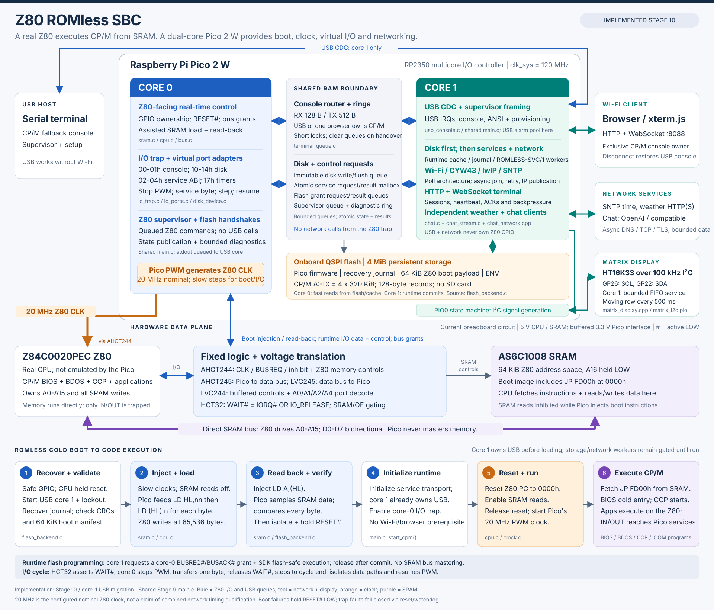
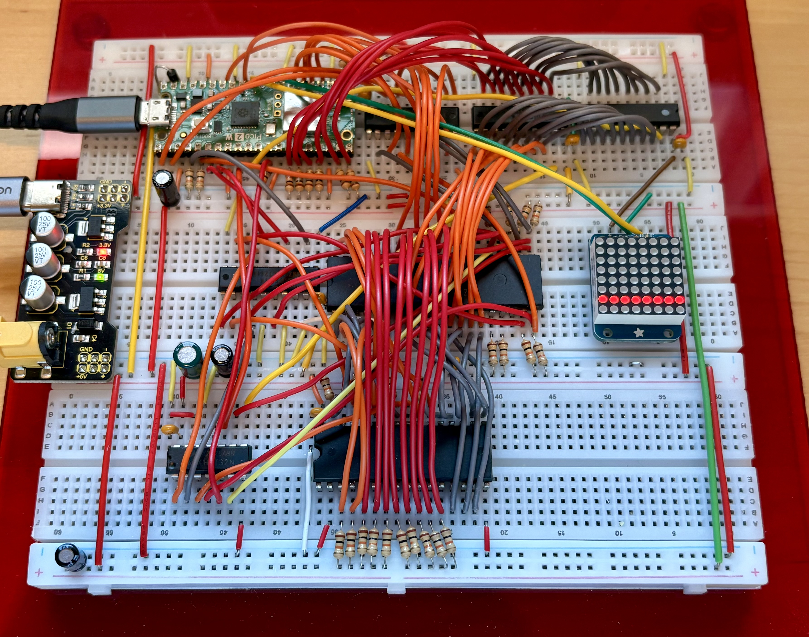

# Z80 ROMless SBC - WIP Engineering and Build Specification

**Repository:** [github.com/gloveboxes/Z80ROMlessSBC](https://github.com/gloveboxes/Z80ROMlessSBC)

## Overview

This breadboard design has been proven to drive the Z80 at its maximum clock
speed of 20 MHz. It pairs a Z80 processor with a Raspberry Pi Pico 2 W to run
CP/M without a ROM chip.

The Z80 runs from 64 KiB of SRAM. The Pico handles clocking, boot loading and
verification, and terminal and disk I/O, with scope for true random number
generation, timers, and internet access.
Four persistent CP/M drives live in the Pico's onboard flash. Phase 9 uses a
USB terminal; Phase 10 adds a browser-based WebSocket terminal.
After bring-up, the [Phase 9 automatic loader](implementation/phase-9-flash-storage.md#automatic-cpm-loader)
starts CP/M on Pico reset, ready for a later picocom connection.

This guide covers the hardware, firmware, and phased tests needed to reproduce
the build. Validate your own wiring and operation as you go; clock-rate
qualification and timing margins require measurements on your build.

## Start building

Install the software listed in [Toolchain](toolchain.md), including the
complete Arm compiler, Python, Pico SDK and USB utilities.

1. Check the [parts inventory](hardware/inventory.md) and read the
   [breadboard and meter basics](hardware/construction.md#before-you-wire).
2. Follow the [implementation plan](implementation/index.md) in order, from
   power checks through SRAM loading, CP/M, and terminal and disk testing.
3. Use the [firmware build and flashing guide](system/firmware-build.md) to
   build and load the firmware for your current phase.

The hardware chapters are detailed references; you do not need to understand
every firmware excerpt before starting. Use the
[glossary](reference/glossary.md) for unfamiliar terms.

## How does it boot without ROM?

The Pico feeds the Z80 instructions that make it write and verify its own
boot image in SRAM. After verification, the Z80 is reset and starts executing
that image from RAM. The Pico never drives the memory address bus or writes
SRAM directly.

See the [loader sequence](hardware/address-interface.md#loader-sequence) for
the protocol and timing, and [Phase 6](implementation/phase-6-sram.md) for
the implementation and hardware checks.

## System architecture

The Pico 2 W is a multicore I/O controller: core 0 generates the nominal
20 MHz Z80 clock and owns assisted SRAM loading and Z80 I/O; core 1
owns USB, runtime storage, Wi-Fi and network clients. Bounded console rings
and request/result mailboxes separate the two cores. The Z80 itself writes
SRAM during loading and executes CP/M directly from SRAM after verification
and reset. USB supervisor commands request Z80 actions through a bounded queue;
USB interrupts and endpoint operations remain on core 1.

[Open or download the full-size SVG](images/system-architecture.svg).
The diagram follows the maintained Phase 10 implementation, which compiles
the Phase 9 automatic-loader application with networking enabled.

## Working and tested breadboard implementation

The breadboard implementation shown below has been built and tested, running
the Z80 at 20 MHz with CP/M executing from SRAM. It brings together the Z80,
Pico 2 W, SRAM, and interface logic across three BB830 breadboards.

Follow the [staged implementation plan](implementation/index.md) to reproduce
the build and validate each stage, from power and clock checks through ROMless
boot loading, terminal access, and persistent disk I/O.

## Explore further

- [USB CP/M terminal and flash storage](implementation/phase-9-flash-storage.md) -
  load CP/M, reach the prompt, and test persistent disk I/O.
- [System operation](system/operation.md) -
  virtual I/O, flash storage, and runtime coordination.
- [I/O ports and services](system/io-ports.md) -
  the terminal and disk interface, plus ROMLESS-SVC/1 timers, clock, utilities
  and persistent environment variables.
- [CP/M documentation](cpm-dcc/index.md) -
  boot-image construction, disk media, and software compatibility.
- [Firmware testing](system/firmware-testing.md) -
  host tests, Z80 emulation, and hardware validation boundaries.
- [Pico flashing and USB supervisor tools](tools/pico-tools.md) -
  environment setup, verified firmware and selective disk updates, serial
  discovery, clean stop, and journal diagnostics.
- [Source index](reference/source-index.md) -
  maintained firmware, tools, and implementation guides.
