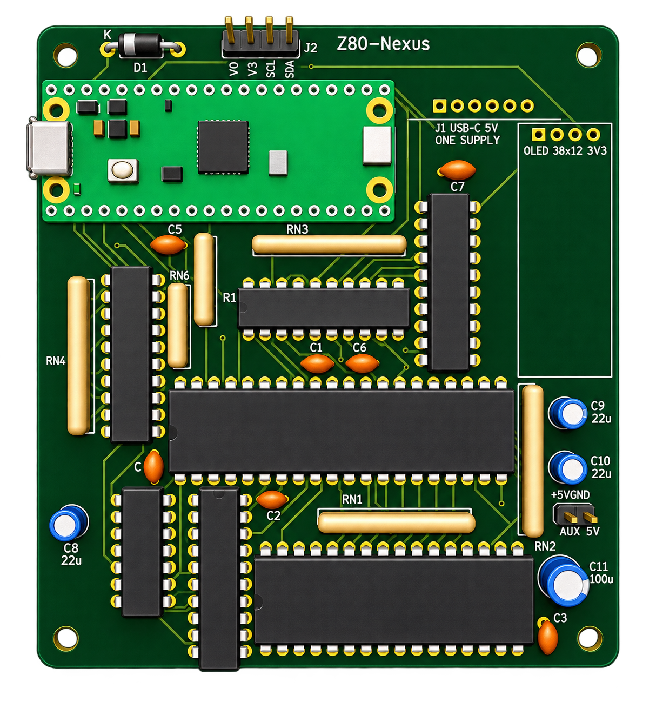

# DIP / Through-Hole PCB

This page covers the **DIP / through-hole design** in `hardware/kicad/`.
For the other design, see the [partial-SMT PCB](smt.md), or
[compare both boards](variants.md). This is the budget-oriented option
for one hand-built machine: populate one board from the bare-PCB batch
without paying for factory assembly.

The PCB is a **separate physical implementation** of the Z80 ROMless SBC:
a **85 x 96 mm**, four-layer, through-hole board implementing the current
eight-package assisted-loader circuit. It includes a socket and full body
reservation for the **38 x 12 mm OLED**, six resistor arrays for all 40 pull
branches, and **four corner M2.5 standoff holes**.
The USB-C power breakout mounts directly on the PCB using six soldered pins.

The IC set is shared with the 20 MHz prototype. The PCB targets **20 MHz**
and has its own routing measurements and qualification requirements.
Matching electrical connectivity does not establish physical operation.

The [Phase 0-10 implementation plan](../implementation/index.md) remains the
three-BB830 breadboard build. Do not use its socket-row positions or
incremental jumper-wiring instructions as PCB assembly instructions.

| Page | Covers |
| --- | --- |
| [PCB inventory](inventory.md) | PCB-specific fitted parts, sockets, connectors, mechanical items, and differences from the breadboard BOM |
| [Design considerations](design-considerations.md) | Layer stack, component placement, power sequencing, routing, timing, and assembly constraints |
| [Shared electrical reference](../hardware/pin-mapping.md) | Exact IC pin assignments and SRAM-control logic |
| [Shared Pico firmware](../system/firmware-build.md) | Phase programs, CP/M images and Pico provisioning; PCB qualification is separate |

## Board preview

*Preview exported from the current KiCad layout and enhanced using ChatGPT. Click to enlarge it.
IC and Pico models are shown, but socket, OLED, USB-C breakout and standoff
models are not included. The render does not establish physical assembly
clearance.*

## Design status and boundaries

The schematic has **30 components, 71 real nets and 278 connected pin
endpoints**, excluding the ERC-only power marker. All **30 schematic
footprints and 278 connected endpoints** are on the PCB, including the
onboard J1 USB-C power breakout. Its other four pins have isolated solder
pads, not signal connections. Revision B has no test points: the circuit is
proven on the prototype, so probe IC pins or socket leads directly. Four 2.7 mm NPTH mounting footprints are additional mechanical
features. The corner holes are 4 mm from both adjacent edges, with
**77 x 88 mm** centre spacing for four M2.5 standoffs.

The routed PCB and its fabrication files have passed the repository's
connectivity, layout, and generation checks. **This is not a
hardware-qualified design.** Start physical bring-up at 1 MHz. Qualification
through **20 MHz** is the PCB design target, not a demonstrated operating
speed for this board.

Electrical requirements and applicable firmware tests are shared, but PCB
assembly and qualification records must be separate. A passing breadboard
does not qualify the PCB, and a clean PCB does not qualify the breadboard.
An independently documented PCB assembly/bring-up sequence and measured
timing evidence are still required before claiming a working hardware build.

## Editable sources and drawings

Paths below are relative to the repository root.

| Artifact | Purpose |
| --- | --- |
| [KiCad project](https://github.com/gloveboxes/Z80ROMlessSBC/blob/main/hardware/kicad/z80_romless_sbc.kicad_pro) | Project configuration and design rules |
| [Native schematic](https://github.com/gloveboxes/Z80ROMlessSBC/blob/main/hardware/kicad/z80_romless_sbc.kicad_sch) | Electrical connections and fitted component values |
| [Routed PCB](https://github.com/gloveboxes/Z80ROMlessSBC/blob/main/hardware/kicad/z80_romless_sbc.kicad_pcb) | Editable placement, copper, outline, and silkscreen |
| [Schematic PDF](https://github.com/gloveboxes/Z80ROMlessSBC/blob/main/hardware/kicad/exports/z80_romless_sbc.pdf) | Full electrical drawing |
| [PCB SVG](https://github.com/gloveboxes/Z80ROMlessSBC/blob/main/hardware/kicad/exports/z80_romless_sbc-pcb.svg) / [PDF](https://github.com/gloveboxes/Z80ROMlessSBC/blob/main/hardware/kicad/exports/z80_romless_sbc-pcb.pdf) | Copper, silkscreen, and outline drawings |
| [Board preview](https://github.com/gloveboxes/Z80ROMlessSBC/blob/main/hardware/kicad/exports/z80_romless_sbc-pcb.png) | 3D board rendering; absent component/socket models cannot establish assembly clearance |
| [DRC report](https://github.com/gloveboxes/Z80ROMlessSBC/blob/main/hardware/kicad/reports/z80_romless_sbc-drc.json) / [board statistics](https://github.com/gloveboxes/Z80ROMlessSBC/blob/main/hardware/kicad/reports/z80_romless_sbc-stats.json) | Generated layout evidence |

## Source ownership and regeneration

The schematic generator, `scripts/build-kicad-schematic.py`, owns component
values, exact pin/net assignments, symbols, and the net manifest.
`scripts/build-kicad-pcb.py` owns placement, board geometry, netclasses,
silkscreen, GND/+5V plane and stack-up setup, and PCB invariants.

The normalized unrouted input is
`hardware/kicad/reports/z80_romless_sbc.dsn`; the accepted routing session is
`hardware/kicad/reports/z80_romless_sbc.ses`. Regeneration must reproduce that
session's exact copper, not silently substitute an independently edited route.

Follow the checkout's
[KiCad generation instructions](https://github.com/gloveboxes/Z80ROMlessSBC/blob/main/hardware/kicad/README.md).
Keep the project closed while generating or replacing its files. The separate
router image is built from `scripts/freerouting/Containerfile`; it uses
checksum-pinned Freerouting and Java with network access disabled during
routing. No separate checkout is needed.

Before accepting regenerated outputs, require zero ERC violations, zero DRC
violations and unconnected items, matching pin/net and component-value
manifests, and matching routing-session copper. Publish the drawings, BOM,
and fabrication package together only after these gates pass.

## Fabrication package

The manufacturing outputs are under `hardware/kicad/fabrication/`.

| Artifact | Purpose |
| --- | --- |
| [Gerber/drill ZIP](https://github.com/gloveboxes/Z80ROMlessSBC/blob/main/hardware/kicad/fabrication/z80_romless_sbc-gerbers.zip) | Copper, mask, silkscreen, board edges, and plated/non-plated drills |
| [Generated BOM](https://github.com/gloveboxes/Z80ROMlessSBC/blob/main/hardware/kicad/fabrication/z80_romless_sbc-bom.csv) | Authoritative fitted component references, values, and footprints |
| [Placement CSV](https://github.com/gloveboxes/Z80ROMlessSBC/blob/main/hardware/kicad/fabrication/z80_romless_sbc-positions.csv) | Through-hole component positions |
| [IPC-D-356 netlist](https://github.com/gloveboxes/Z80ROMlessSBC/blob/main/hardware/kicad/fabrication/z80_romless_sbc.ipc) | Electrical manufacturing-test netlist |

Use a four-layer, 1.6 mm FR-4 fabrication stack with plated through holes and
both solder masks. Confirm the manufacturer's actual stack-up, internal
cutout process, and drill capabilities before ordering. Review the
[inventory](inventory.md) against purchased parts and the
[mechanical constraints](design-considerations.md#placement-and-mechanical-clearance);
the generated files alone do not establish that every purchased socket or
component fits.
