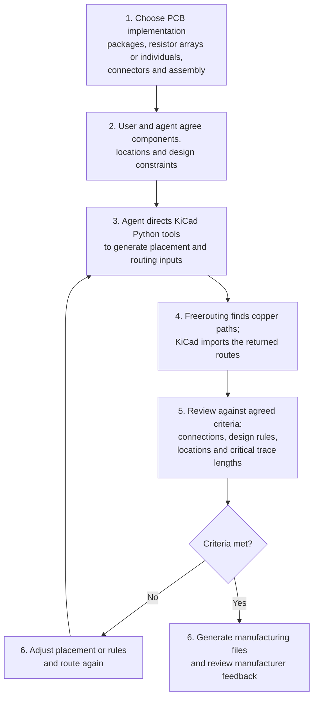

# PCB Layout

For this Z80 SBC, a breadboard layout was built first to prove the hardware
and software design. The PCB process carries that proven design onto a
manufacturable board, with the user and agent agreeing on goals, components
and constraints before generating, routing and reviewing the layout.

1. **Choose the PCB implementation.** Adapt the proven circuit to a board:
   choose packages and PCB-specific details such as resistor arrays or
   individual resistors, connectors, and which parts are factory assembled.
2. **Agree on components and constraints.** The user and agent confirm the
   parts, component locations, board size, electrical needs, assembly,
   quantity and budget. The agent explains trade-offs before the user approves
   the design criteria.
3. **Generate the layout.** The agent directs KiCad's Python tools to create
   the schematic, component placement, board shape and routing rules.
4. **Route the connections.** The agent gives the placed design to Freerouting,
   which searches for copper paths and returns them for KiCad to import. The
   router does not choose component locations.
5. **Review against the criteria.** Check that connections are complete and
   design rules pass, then assess requirements such as keeping a component in
   its agreed location or matching critical trace lengths when the design
   requires it.
6. **Iterate and deliver.** If the layout misses a criterion, adjust placement
   or rules and route again. Once checks pass, generate and review the
   manufacturing files.

The routing input is a **DSN** (Specctra Design file); the returned **SES**
(Specctra Session file) contains the proposed routes. **Gerber** and drill
files describe the board layers and holes. For partial-SMT assembly, the
**BOM** (bill of materials) lists parts, and the **CPL** (component placement
list) gives their positions and orientations. Computer checks do not replace
reviewing manufacturer feedback and the assembly placement preview.
