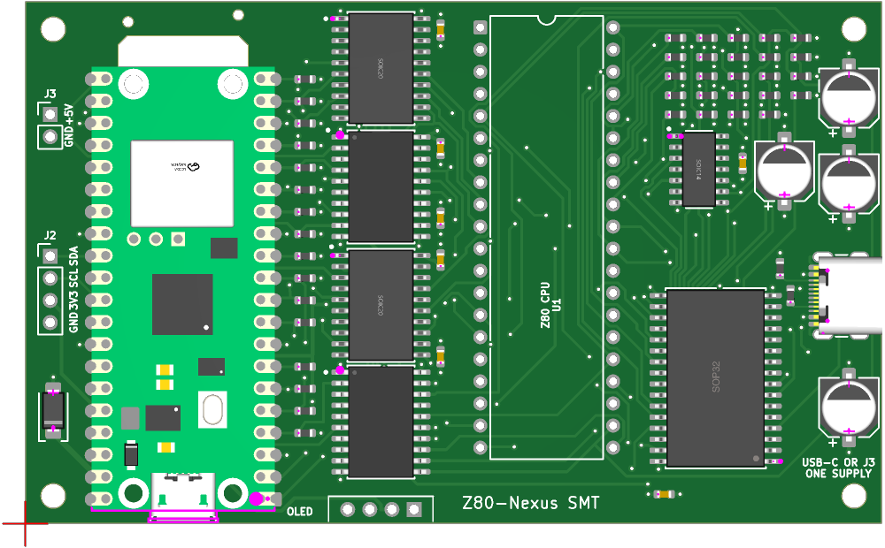

# Partial-SMT PCB

This is the **98.3 x 60 mm**, four-layer design in `hardware/kicad-smt/`.
JLCPCB assembles the top-side surface-mount parts, including the Pico 2 W.
The Z80, OLED socket and J2/J3 headers are hand-soldered.

For a single machine with lower assembly outlay and socketed ICs, consider
the [DIP / through-hole PCB](index.md). See [Choose a PCB design](variants.md)
for the assembly and cost comparison.

| Page | Covers |
| --- | --- |
| [Inventory and assembly](smt-inventory.md) | Exact SMT parts and LCSC numbers, passives and the four hand-fitted items |
| [Design considerations](smt-design-considerations.md) | Replacement SRAM, layout, power sequencing, mechanical fit and placement-preview checks |
| [Shared pin map](../hardware/pin-mapping.md) | Signal connections and SRAM-control logic; use the SMT inventory for package suffixes |
| [Shared firmware](../system/firmware-build.md) | Pico firmware and CP/M provisioning; physical qualification remains board-specific |

## Board preview



*Exported from the SMT KiCad layout. Models illustrate placement but do
not prove purchased-part fit, connector clearance or assembled height.*

## Design status and boundaries

The SMT schematic has **66 components, 73 real nets and 325 connected
endpoints**, excluding ERC-only power markers. The PCB includes those
66 footprints and four additional mechanical mounting-hole footprints.
The assembly BOM includes **62 JLC-assembled parts**; U1, A2, J2 and J3
are intentionally absent from the JLC BOM and placement file.

The schematic and routed board pass the maintained connectivity,
ERC/DRC and generation checks. **This is not hardware qualification.**
Start assembled-board bring-up at **1 MHz** and qualify the 20 MHz target
separately. The breadboard's CPU/SRAM-absent stages cannot be applied
unchanged to a board with factory-soldered SRAM and logic.

## Editable sources and drawings

| Artifact | Purpose |
| --- | --- |
| [KiCad project](https://github.com/gloveboxes/Z80ROMlessSBC/blob/main/hardware/kicad-smt/z80_romless_sbc_smt.kicad_pro) | SMT design rules and project configuration |
| [Native schematic](https://github.com/gloveboxes/Z80ROMlessSBC/blob/main/hardware/kicad-smt/z80_romless_sbc_smt.kicad_sch) | Exact connections, parts and LCSC numbers |
| [Routed PCB](https://github.com/gloveboxes/Z80ROMlessSBC/blob/main/hardware/kicad-smt/z80_romless_sbc_smt.kicad_pcb) | SMT placement, copper, outline and silkscreen |
| [Schematic PDF](https://github.com/gloveboxes/Z80ROMlessSBC/blob/main/hardware/kicad-smt/exports/z80_romless_sbc_smt.pdf) | Electrical drawing |
| [PCB SVG](https://github.com/gloveboxes/Z80ROMlessSBC/blob/main/hardware/kicad-smt/exports/z80_romless_sbc_smt-pcb.svg) / [PDF](https://github.com/gloveboxes/Z80ROMlessSBC/blob/main/hardware/kicad-smt/exports/z80_romless_sbc_smt-pcb.pdf) | Layer and assembly drawings |
| [ERC report](https://github.com/gloveboxes/Z80ROMlessSBC/blob/main/hardware/kicad-smt/reports/z80_romless_sbc_smt-erc.json) / [DRC report](https://github.com/gloveboxes/Z80ROMlessSBC/blob/main/hardware/kicad-smt/reports/z80_romless_sbc_smt-drc.json) | Generated electrical and layout checks |

## Source ownership and regeneration

`scripts/build-kicad-smt-schematic.py` owns the schematic, symbols, exact
pin/net assignments, component details and manifest.
`scripts/build-kicad-smt-pcb.py` owns the SMT placement, geometry, rules,
keepouts, models and board checks. `scripts/export-jlc-assembly.py`
generates the JLC BOM and component placement list (CPL).

The accepted route is
`hardware/kicad-smt/reports/z80_romless_sbc_smt.ses`; its normalized
unrouted input is `z80_romless_sbc_smt.dsn` in the same directory.
Do not substitute files from the DIP project.

With the project saved and closed in KiCad, run from the repository root:

```sh
PYTHON=.venv-kicad/bin/python npm run kicad:smt
```

Follow the [SMT project build instructions](https://github.com/gloveboxes/Z80ROMlessSBC/blob/main/hardware/kicad-smt/README.md)
for prerequisites. The pipeline checks ERC, manifest parity, PCB/DSN
reproduction, zone-refilled DRC, route budgets, solder-mask/silkscreen
clearances and JLC BOM/CPL consistency before publishing the outputs.
It does not modify the DIP project in `hardware/kicad/`.

## Fabrication and assembly files

All files in this table belong to **the SMT design**.

| File | Use |
| --- | --- |
| [Gerber/drill ZIP](https://github.com/gloveboxes/Z80ROMlessSBC/blob/main/hardware/kicad-smt/fabrication/z80_romless_sbc_smt-gerbers.zip) | Upload for the PCB order |
| [JLC assembly BOM](https://github.com/gloveboxes/Z80ROMlessSBC/blob/main/hardware/kicad-smt/fabrication/assembly/z80_romless_sbc_smt-jlc-bom.csv) | Upload as the PCBA BOM |
| [JLC CPL](https://github.com/gloveboxes/Z80ROMlessSBC/blob/main/hardware/kicad-smt/fabrication/assembly/z80_romless_sbc_smt-jlc-cpl.csv) | Upload as the PCBA component placement file |
| [Full BOM](https://github.com/gloveboxes/Z80ROMlessSBC/blob/main/hardware/kicad-smt/fabrication/z80_romless_sbc_smt-bom.csv) | Purchase/assembly reference including hand-soldered parts; not the JLC upload BOM |
| [KiCad positions](https://github.com/gloveboxes/Z80ROMlessSBC/blob/main/hardware/kicad-smt/fabrication/z80_romless_sbc_smt-positions.csv) | Complete placement reference; use the corrected JLC CPL for PCBA |
| [IPC-D-356 netlist](https://github.com/gloveboxes/Z80ROMlessSBC/blob/main/hardware/kicad-smt/fabrication/z80_romless_sbc_smt.ipc) | Electrical manufacturing-test netlist |

The ZIP contains four copper layers, front paste, both solder masks and
silkscreens, the outline/antenna window, job file and separate plated and
non-plated drill files.

## JLCPCB order settings

- **PCB:** FR-4, four layers, 1.6 mm, **98.3 x 60 mm**.
- **Layer order:** front, GND, +5V, back; 1 oz outer and 0.5 oz inner copper.
- **Finish:** LeadFree HASL, green solder mask and white silkscreen.
- **Cutout:** enclosed Pico antenna window, with the top FR-4 bridge retained.
- **PCBA:** top side only, **Economic PCBA**. The board's 60 mm height is
  below the 70 x 70 mm single-board minimum for Standard PCBA; Standard
  would require a panel with edge rails and fiducials.
- Upload the matching SMT ZIP, JLC BOM and JLC CPL, then review every
  component's [rotation and polarity](smt-design-considerations.md#assembly-preview-and-mechanical-checks).
- Check current part availability and any required Pico 2 W X-ray
  inspection in the quote. Pre-order the module into your JLC parts
  library if necessary.

The five-board bare-PCB batch and the PCBA assembly quantity are separate;
check both in the quote. Include assembly and component-loading charges
when comparing this option with one hand-built DIP machine.
