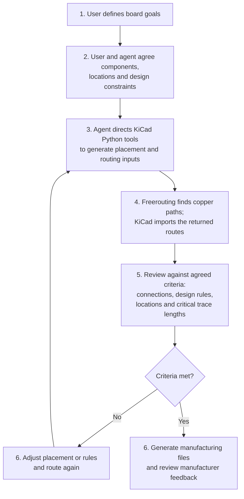

# Choose a PCB Design

## How the PCB layout is made

1. **Define goals.** The user describes what the board should do and how it
   will be used.
2. **Agree on components and constraints.** The user and agent settle key parts,
   electrical needs, connectors, component locations, board size, assembly,
   quantity and budget. The agent explains trade-offs; the user confirms the
   design criteria before implementation.
3. **Generate the layout.** The agent directs KiCad's Python tools to create
   the schematic, component placement, board shape and routing rules.
4. **Route the connections.** The agent gives the placed design to Freerouting,
   which searches for copper paths and returns them for KiCad to import. The
   router does not choose component locations.
5. **Review against the criteria.** Check that connections are complete and
   design rules pass, then assess requirements such as keeping a component in
   its agreed location or matching critical trace lengths when the design
   requires it.
6. **Iterate and deliver.** If the layout misses a criterion, adjust placement
   or rules and route again. Once checks pass, generate and review the
   manufacturing files.

The routing input is a **DSN** (Specctra Design file); the returned **SES**
(Specctra Session file) contains the proposed routes. **Gerber** and drill
files describe the board layers and holes. For partial-SMT assembly, the
**BOM** (bill of materials) lists parts, and the **CPL** (component placement
list) gives their positions and orientations. Computer checks do not replace
reviewing manufacturer feedback and the assembly placement preview.

There are **two separate printed circuit board (PCB) designs** for the Z80
ROMless SBC. Both implement the proven breadboard's assisted-loader circuit,
but use different component packages, SRAM parts and assembly methods.

The **dual in-line package (DIP) / through-hole PCB** is intended for hand
assembly with socketed ICs. The **partial surface-mount technology (SMT)
PCB** is intended for JLCPCB assembly of the surface-mount parts, leaving
four items to hand-solder. It is not an all-SMT board: the Z80 remains a
DIP-40 device.

## Compare the two designs

| Feature | DIP / through-hole PCB | Partial-SMT PCB |
| --- | --- | --- |
| Best suited to | One hand-built machine, lower assembly outlay and easy IC replacement | A compact board with factory-assembled SMT parts |
| Board | 85 x 96 mm, four layers, 1.6 mm FR-4 | 98.3 x 60 mm, four layers, 1.6 mm FR-4 |
| KiCad project directory | `hardware/kicad/` | `hardware/kicad-smt/` |
| Z80 | Z84C0020PEC, socketed DIP-40 | Z84C0020PEC, hand-soldered DIP-40 |
| SRAM | AS6C1008-55PCN, DIP-32, 55 ns | IS62C1024AL-35QLI, SOP-32, 35 ns |
| Logic ICs | Socketed DIP packages | JLC-assembled SOIC packages |
| Pico 2 W | Plug-in headers/socket strips | JLC-reflowed castellated module |
| Pull resistors | Six bussed arrays, 40 branches | Forty individual 10k 0603 resistors |
| USB-C power entry | Six-pin breakout module | Onboard receptacle and two 5.1k CC pull-downs |
| Assembly | Hand assembly | Top-side SMT assembly plus Z80, OLED socket and J2/J3 |
| Manufacturing files | Gerber/drill ZIP and full bill of materials (BOM) | Separate Gerber/drill ZIP, full BOM, JLC BOM and component placement list (CPL) |

**Choose the documentation and manufacturing package for the same design.**
The two BOMs, footprints, board outlines and placement files are not
interchangeable.

| Design | Start here | Parts | Layout and assembly constraints |
| --- | --- | --- | --- |
| DIP / through-hole | [Overview and fabrication](index.md) | [Inventory](inventory.md) | [Design considerations](design-considerations.md) |
| Partial-SMT | [Overview and fabrication](smt.md) | [Inventory and assembly](smt-inventory.md) | [Design considerations](smt-design-considerations.md) |

## Building just one machine

**The DIP design is the budget-oriented choice if you want one working
board and are willing to solder it yourself.** Populate one PCB and keep
the other bare boards as spares; there are no factory assembly, stencil
or component-loading charges.

JLCPCB's standard bare-PCB order starts at **five boards for either
design**, not only for SMT. The extra cost of the partial-SMT option is
the factory assembly and its associated charges, in addition to the
PCBs and components. The number of bare PCBs manufactured and the number
assembled are separate order settings; do not assume that a five-PCB
order requires all five to be populated.

For multiple machines, factory assembly spreads setup costs and reduces
hand-soldering work. Compare the complete current quote, including
components, assembly, shipping and taxes, rather than just the bare-PCB
price. Check JLCPCB's [live quote](https://jlcpcb.com/quote) for quantities
and its [assembly price breakdown](https://jlcpcb.com/help/article/pcb-assembly-price)
for the applicable charges.

## Shared circuit, separate qualification

Both boards retain the same Pico GPIO assignments, Z80-only address bus,
buffered A16 bank selection, fixed HCT32 logic and assisted SRAM loading.
Both provide a 3.3 V OLED connection and use GND/+5V inner planes.
The [shared pin map](../hardware/pin-mapping.md) describes the signal
connections; each board's inventory specifies the actual package and
part number.

The ISSI SRAM on the SMT board has the same SOP-32 pin assignment as the
Alliance DIP SRAM, but different voltage thresholds and timing limits.
Its 35 ns access time does not by itself qualify the board at 20 MHz.

!!! warning "PCB qualification is separate from the breadboard"
    The [Phase 0-10 build plan](../implementation/index.md) describes the
    three-BB830 breadboard prototype, not either PCB's assembly procedure.
    Each PCB needs its own power, assembly and timing checks, starting at
    **1 MHz**. Neither a passing breadboard nor clean ERC/DRC reports
    establish operation of an assembled PCB at the **20 MHz target**.
