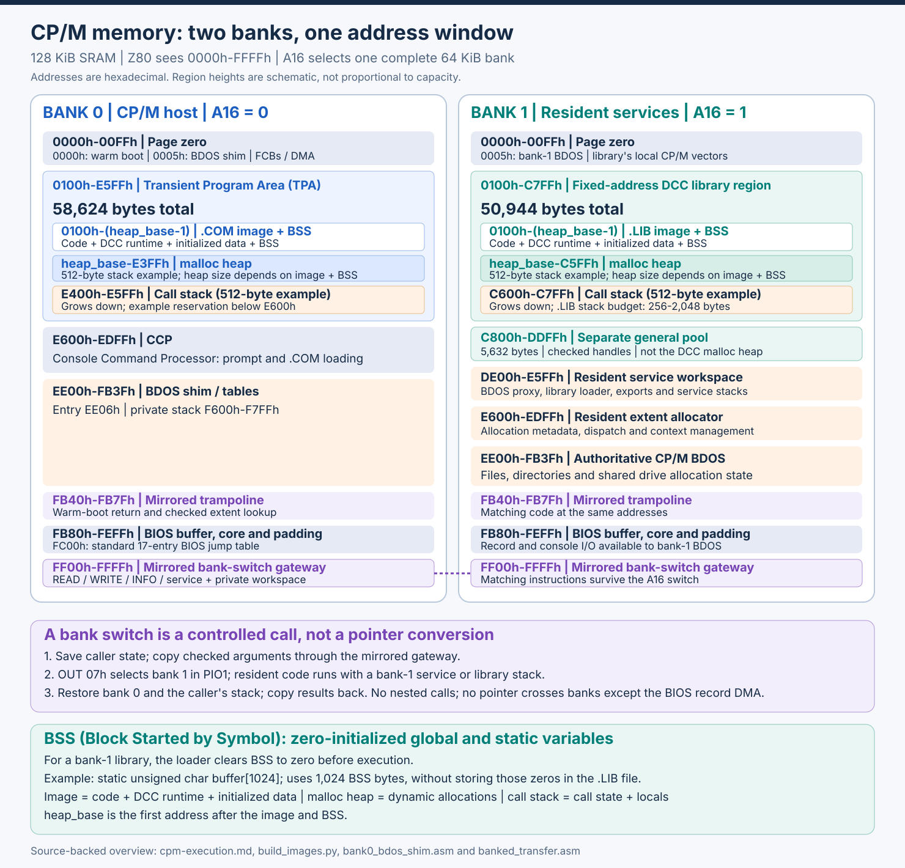
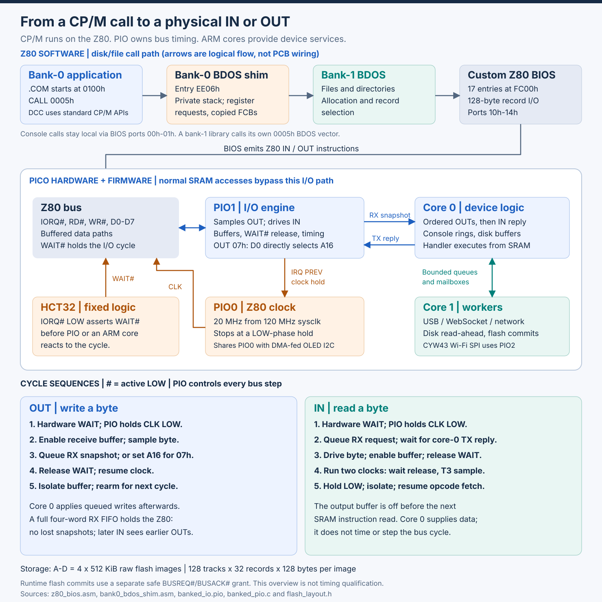
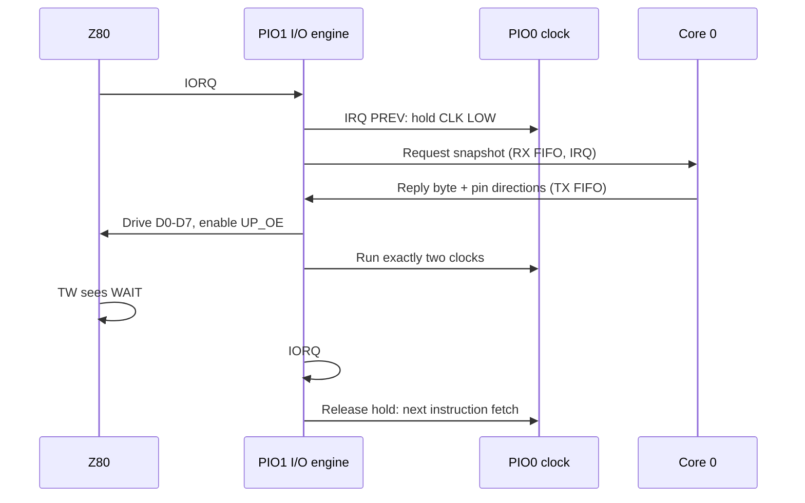

# CP/M execution, banked memory and PIO I/O

In Phases 9 and 10, the Z80 runs CP/M directly from SRAM; the Pico supervises boot and I/O, rather than emulating the CPU. The diagrams show the architecture; the [memory](#cpm-memory-map-reference), [PIO](#pio-io-engine-reference) and [BIOS](#custom-bios-reference) sections provide the implementation reference.

## Building applications across two banks

Applications can use any compiler targeting the Z80 instruction set, provided its output and runtime are compatible with CP/M. Using both banks also requires the banked-memory interface: generating Z80 code alone does not provide cross-bank calls. DCC has specific compiler and linker support for [building fixed-address bank-1 libraries](https://davidly.github.io/dcc/02-build-and-link/#fixed-address-bank-1-libraries), including generated typed APIs and host wrappers.

Split the application into a bank-0 `.COM` host for startup and user interaction, and a bank-1 `.LIB` service for processing and large, service-owned data. Build the library first, then the host with its generated wrappers and BANKSDK. Calls are synchronous and copy bounded arguments rather than sharing pointers; each bank has its own code, data, heap and stack budget. See [LIBDEMO](https://github.com/gloveboxes/Z80ROMlessSBC/tree/main/examples/LIBDEMO) for a working example and the [library specification](../cpm-dcc/bank1-library-spec.md) for limits.

## Two banks, one address window

[](../images/cpm-banked-memory.svg)

[Open or download the full-size memory-map SVG](../images/cpm-banked-memory.svg). Region heights are schematic. Addresses are hexadecimal and ranges inclusive unless labelled otherwise; `#` means active LOW.

The 128 KiB SRAM has two 64 KiB banks, each mapped to `0000h`-`FFFFh`. PIO1 completes `OUT 07h` by sending D0 to A16: 0 selects bank 0, 1 selects bank 1. This switches code, data, stack and vectors together.

- **Bank 0:** `.COM` programs start at `0100h`; the TPA holds 58,624 bytes.
- **Bank 1:** one fixed-address `.LIB` uses `0100h`-`C7FFh`, 50,944 bytes.

Both budgets include image (code, DCC runtime and initialized data), BSS, `malloc` heap and call stack—not just free heap. **BSS (Block Started by Symbol)** holds zero-initialized globals/statics. For example, `static unsigned char buffer[1024];` reserves 1,024 bytes; the library loader zeros them without storing those zeros in `.LIB`. `heap_base` follows the image and BSS.

The diagram uses **512-byte call stack examples**:

| Region | Bank 0 TPA (inclusive) | Bank 1 library (inclusive) |
| --- | --- | --- |
| Image + BSS | `.COM`: `0100h` to `heap_base - 1` | `.LIB`: `0100h` to `heap_base - 1` |
| `malloc` heap | `heap_base` to `E3FFh` | `heap_base` to `C5FFh` |
| Call stack (512 bytes) | `E400h` to `E5FFh` | `C600h` to `C7FFh` |

Bank-0 placement is illustrative and application-specific. Bank 1's `.LIB` header sets a 256-2,048-byte stack in 256-byte units below `C800h`; its last heap byte is `C800h - stack size - 1`. Each program/library's linked image and BSS determine its own `heap_base`. The separate 5,632-byte pool at `C800h`-`DDFFh` uses checked handles; RESET does not unload the library or reset its `malloc` heap.

### Why switching banks does not lose execution

The `FF00h` gateway and `FB40h` trampoline have matching code in both banks, so instruction fetching survives an A16 switch. Applications use checked BANKSDK transfers and generated wrappers, not cross-bank pointers or arbitrary bank toggles. See [stack switch and return](#stack-switch-and-return) for saved state and [library layout](../cpm-dcc/bank1-library-spec.md#library-memory-layout) for image, BSS and stack budgets.

## From a CP/M call to physical I/O

[](../images/cpm-pio-execution.svg)

[Open or download the full-size execution-flow SVG](../images/cpm-pio-execution.svg). Arrows show logical call/data flow, not PCB wires.

### BDOS selects files; BIOS transfers records

1. Bank-0 `CALL 0005h` enters the BDOS shim at `EE06h`.
2. Console calls stay local; disk/file calls pass their request in registers and copy only File Control Blocks (FCBs) and directory-search records to and from bank 1, using the private `F600h`-`F7FFh` stack.
3. Bank-1 BDOS selects files and records, then calls BIOS at `FC00h`. For a bank-0 read or write, BIOS selects bank 0 around the block transfer so the record moves directly to or from the caller's DMA. Libraries reach BDOS through their own `0005h` vector.
4. BIOS emits port I/O; PIO1 completes the bus cycle, core 0 supplies device data, and core 1 handles queued storage/transport work.

Disk BIOS uses ports `10h`-`14h`, computes `track * 32 + sector`, polls status and transfers 128 bytes with `INIR`/`OTIR`. Normal, directory and unallocated-write commands remain distinct; `SETDMA` sets a software buffer, not hardware DMA. Console I/O uses ports `00h`-`01h`.

A-D are **four 512 KiB onboard-flash images**: 128 tracks x 32 records x 128 bytes each. System records and filesystem metadata reduce file capacity; no SD card is used.

## Boot, warm boot and flash commits

- **Cold boot:** core 0 recovers the journal, validates the image, then injects instructions under slow clocks so the Z80 loads/verifies 64 KiB in bank 0 and 8,960 bytes in bank 1 (page zero plus `DE00h`-`FFFFh`). Owners initialize `0100h`-`DDFFh` before use. PIO starts only after verification.
- **CP/M entry:** BIOS installs `0000h` (warm boot) and `0005h` (BDOS) vectors, then enters CCP at `E600h`; programs start at `0100h`.
- **Application entry:** the banked CCP calls the launch trampoline at `FB68h` before entering each `.COM` at `0100h`. Resident service E=10 reclaims the entire 5,632-byte shared pool, invalidates the previous library, clears its DMA/search context and initializes application-scoped generation/epoch state. Neither abandoned allocations nor exhausted counters carry into the next app, including successive SUBMIT commands and apps that exit with `RET`.
- **Warm boot:** selects bank 0, flushes writes and reloads 44 system records from Drive A, restoring CCP and the bank-0 shim before the prompt.
- **Flash commit:** core 0 parks the Z80 with `BUSREQ#`/`BUSACK#`, drains I/O and pauses the engine for core-1 programming, then rearms and returns the bus. The Pico never drives SRAM addresses or write strobes.

Deploy matching firmware, boot package and Drive A system records; rebuild `.COM`/`.LIB` clients when their ABI changes. Diagrams and host tests are not [hardware timing qualification](../implementation/frequency-qualification.md).

## Maintained implementation

| Surface | Source |
| --- | --- |
| Memory layout and boot image | [build_images.py](https://github.com/gloveboxes/Z80ROMlessSBC/blob/main/src/cpm/build_images.py), [sram.c](https://github.com/gloveboxes/Z80ROMlessSBC/blob/main/src/common/sram.c) |
| BDOS forwarding and BIOS | [bank0_bdos_shim.asm](https://github.com/gloveboxes/Z80ROMlessSBC/blob/main/src/cpm/bank0_bdos_shim.asm), [z80_bios.asm](https://github.com/gloveboxes/Z80ROMlessSBC/blob/main/src/cpm/z80_bios.asm) |
| Mirrored gateway and library control | [banked_transfer.asm](https://github.com/gloveboxes/Z80ROMlessSBC/blob/main/src/common/banked_transfer.asm), [banked_extensions.asm](https://github.com/gloveboxes/Z80ROMlessSBC/blob/main/src/common/banked_extensions.asm) |
| PIO timing and ordered FIFO dispatch | [banked_io.pio](https://github.com/gloveboxes/Z80ROMlessSBC/blob/main/src/common/banked_io.pio), [banked_pio.c](https://github.com/gloveboxes/Z80ROMlessSBC/blob/main/src/common/banked_pio.c) |
| Disk geometry and backing storage | [flash_layout.h](https://github.com/gloveboxes/Z80ROMlessSBC/blob/main/src/common/include/z80sbc/flash_layout.h), [flash_backend.c](https://github.com/gloveboxes/Z80ROMlessSBC/blob/main/src/common/flash_backend.c) |

## CP/M memory map reference

Bank 0 (TPA excludes CCP; all resident workspace stays above it):

| Region | Address range | Role |
| --- | --- | --- |
| Page zero | `0x0000`-`0x00FF` | CP/M vectors, default FCBs, DMA buffer, and command tail |
| Transient Program Area (TPA) | `0x0100`-`0xE5FF` | `.COM` image (code, DCC runtime, initialized data), BSS, `malloc` heap and call stack |
| CCP | `0xE600`-`0xEDFF` | Console Command Processor, reloaded after a warm boot |
| BDOS shim and tables | `0xEE00`-`0xFB3F` | Bank-0 console and disk/file proxy; entry at `0xEE06` |
| BDOS shim private stack | `0xF600`-`0xF7FF` | 512-byte stack inside the bank-0 BDOS slot; protects the CCP code below its small stack |
| Mirrored trampoline | `0xFB40`-`0xFB7F` | Bank-1 warm-boot return and checked-transfer extent lookup (`0xFB48`) |
| Reserved BDOS padding | `0xFB80`-`0xFBFF` | 128-byte BIOS directory buffer |
| BIOS core | `0xFC00`-`0xFEFD` | 766-byte Z80-optimized boot, console, disk, translation and startup-report routines |
| Spare padding | `0xFEFE`-`0xFEFF` | 2 bytes |
| BIOS bank extension | `0xFF00`-`0xFFFF` | READ/WRITE/INFO/HEAP entry points, mirrored code and private workspace |

CCP occupies `0800h` bytes; the BDOS slot occupies `0E00h`, including the final 128-byte directory buffer. `bios.bin` is 1,024 bytes: core, padding and mirrored extension. DCC locates BDOS through `JP EE06h` at `0005h` but must stay below `E600h`. The shim's private stack protects CCP code during nested transfers.

Bank 1 (`DE00h` and above is reserved for system code):

| Bank-1 address | Role |
| --- | --- |
| `0000h–00FFh` | CP/M page zero |
| `0100h–(heap_base-1)` | Fixed `.LIB` image (code, DCC runtime, initialized data) and BSS |
| `heap_base–(C800h-stack-1)` | DCC library `malloc` heap, starting after linked BSS |
| `(C800h-stack)–C7FFh` | Pinned library stack; size comes from the `.LIB` header |
| `C800h–DDFFh` | General `bmalloc` pool, 5,632 bytes |
| `DE00h–E5FFh` | Resident loader, proxy and service workspace |
| `E600h–EDFFh` | Extent allocator metadata/code |
| `EE00h–FB3Fh` | Authoritative CP/M BDOS |
| `FB40h–FB7Fh` | Mirrored warm-boot return and extent lookup |
| `FB80h–FEFFh` | BIOS buffer and core |
| `FF00h–FFFFh` | Mirrored bank-switch gateway |

## PIO I/O engine reference

Only `IN`/`OUT` reach the Pico; normal memory cycles access SRAM directly with the Pico data paths isolated. PIO owns all runtime bus timing.

### PIO terminology

| Term | Meaning |
| --- | --- |
| PIO block | A programmable I/O peripheral. The RP2350 has three: PIO0, PIO1 and PIO2. Each has 32 words of instruction memory shared by its state machines. |
| State machine (SM) | A tiny independent processor inside a block (four per block). It executes one PIO instruction per system clock: 8.33 ns at the 120 MHz supervisor clock, so its timing is exact and repeatable. |
| Scratch and shift registers | Each SM has X and Y scratch registers, an output shift register (OSR) for data going to pins, and an input shift register (ISR) for data read from pins. |
| Pin mappings | Each SM is configured with windows of GPIOs: `IN` reads from them, `OUT` and `SET` drive them, *side-set* drives a pin in the same instruction as other work, and `JMP PIN` branches on one pin. |
| FIFOs | Two four-word queues per SM. The SM *pushes* to the RX FIFO for the ARM cores to read; the ARM cores put words in the TX FIFO for the SM to *pull*. *Autopush* pushes the ISR automatically when it is full. |
| IRQ flags | Eight flags per block that SMs set, clear and wait on. They can interrupt an ARM core, and on the RP2350 `IRQ PREV` sets a flag in the neighbouring (previous) block. |

### The role of each PIO block

| Block | Program | Role |
| --- | --- | --- |
| PIO0 | `banked_clock`, 4 words | Generates the 20 MHz Z80 clock (3 ticks HIGH, 3 LOW) on GP2. It stops in a LOW phase whenever PIO0 IRQ flag 1 (I/O hold) or flag 2 (core-0 hold) is set. It shares PIO0 with the status OLED's I²C program. |
| PIO1 | `banked_io`, 29 words | The I/O engine. Claimed exclusively; it recognises, completes and times every Z80 `IN` and `OUT`, and drives the data bus, buffer enables, WAIT release and SRAM bank select (A16). |
| PIO2 | (not used by the Z80) | Left for the CYW43 Wi-Fi driver, whose SPI bus claims the highest free PIO block. |

PIO1 holds PIO0's clock with `IRQ PREV`, without ARM timing. The DMA-fed OLED I2C state machine shares PIO0 but uses no IRQ flags.

#### PIO1 pin windows

| Mapping | GPIOs | Signals |
| --- | --- | --- |
| `IN` | GP10 upwards | D0-D7, A0/A1/A2/A4, RD#, WR# |
| `OUT` (10 pins) | GP8-GP17 | A16 bank select, IO_RELEASE, D0-D7 |
| `SET` (2 pins) | GP6-GP7 | UP_OE# (Pico drives the Z80 bus), DOWN_OE# (Pico reads the Z80 bus) |
| Side-set | GP9 | IO_RELEASE: releases the hardware WAIT# |
| `JMP PIN` | GP27 | RD#: distinguishes `IN` from `OUT` |

HCT32 asserts WAIT# as soon as IORQ# falls, before PIO reacts.

### How PIO data reaches core 0

PIO1 uses 32-bit FIFO words (bank-select OUTs bypass the FIFOs):

| Direction | Instruction | Word contents |
| --- | --- | --- |
| PIO1 → core 0 (RX) | `in pins, 32` with autopush | A snapshot of the pins: data in bits 0-7, A0/A1/A2/A4 in bits 8-11, RD# in bit 17, WR# in bit 18 |
| Core 0 → PIO1 (TX) | `pull`, `out pins, 10`, `out pindirs, 10` | The reply for an `IN`: pin levels for GP8-GP17 (A16 unchanged, IO_RELEASE LOW, D0-D7) in bits 0-9, then the pin directions to use while driving (bits 10-19) and when idle (bits 20-29) |

The RX-not-empty IRQ runs core 0's SRAM-resident handler: apply OUTs in bus order, then reply to IN. Thus each IN observes all earlier OUTs.

### An OUT cycle

1. IORQ# falls; PIO sets the I/O hold so the clock stops at its next LOW phase, and `JMP PIN` sees RD# HIGH.
2. PIO enables the receive buffer (DOWN_OE#) and lets it settle for eight ticks.
3. For port `07h` it drives D0 onto A16, switching the SRAM bank. For any other port it autopushes the snapshot to core 0.
4. It releases WAIT# while CLK is still LOW, clears the hold so the clock runs freely, waits for IORQ# to rise, then isolates the buffer and rearms WAIT#.

Core 0 applies ordinary writes afterwards. A full four-word RX FIFO holds WAIT# rather than dropping a snapshot.

### An IN cycle



After the reply, PIO runs exactly two clocks: wait release, then T3's falling-edge data sample. It holds CLK LOW and isolates the output buffer before resuming opcode fetching, preventing the Pico from driving the next SRAM read.

### Division of work

| Owner | Responsibility |
| --- | --- |
| PIO0 + PIO1 | All Z80 bus timing: the 20 MHz clock, cycle detection, buffer enables, data drive and sampling, WAIT# release and A16 bank select |
| Core 0 | The Z80's supervisor and the device logic behind its I/O ports |
| Core 1 | USB, Wi-Fi and network services, the web terminal, flash programming and the disk read-ahead |

#### Core 0: PIO1 interrupt

Per-port device work (no USB, network or flash programming in the handler):

| Ports | Work |
| --- | --- |
| `00h-01h` console | Queue output to the shared ring for core 1 (USB or WebSocket), return input bytes, report status without taking the lock |
| `10h-14h` disk | Latch drive and LBA, run commands, serve reads from the SRAM read-ahead or flash, collect 128-byte write records and hand them to core 1 |
| `02h-04h` service ABI | Collect requests for core-1 workers and return their replies |
| `17h` timers | Countdown timers and stopwatches |
| `15h-16h` HTTP | Filename and chunk handshakes with the core-1 HTTP worker |
| `05h`, `06h` | Boot markers and disk-diagnostic results |
| `07h` (IN) | SRAM bank status; `OUT 07h` completes entirely in PIO |

#### Core 0: main loop

- Services flash grants and bounded core-1 supervisor commands: load/verify, start, status, stop, reboot, fault arming and configuration/web reboots.
- Monitors boot markers, boot timeout and disk diagnostics; publishes CPU state.
- For orderly stop: flush, park, drain OUTs, check disk quiescence, then reset or resume.

#### Core 0: boot

See [boot and flash sequencing](#boot-warm-boot-and-flash-commits). Slow stepped clocks are used for loading, not runtime I/O.

### Why it is fast

PIO steps resolve at 8.33 ns with no software timing delays. Reported core-0 device work costs about 1 µs per IN and 1.2-1.3 µs per OUT, excluding IRQ entry/exit; the measured 20 MHz workload polls 225,000-266,000 INs/s. Queued OUTs and PIO-only bank switching avoid waiting for ARM work when FIFO space is available. Core-1 workers use bounded queues/mailboxes.

**Ctrl-] s** reports `[pio]` engine state, `[iolat]` handler cost and `[disk]` read-ahead hits. These measurements are workload-specific, not qualification of every network/storage combination.

### Safety

- Invalid RD#/WR# combinations, a 500 ms stalled cycle or fatal storage error hold the CPU in reset.
- Bus-grant pull-ups keep IORQ#, RD# and WR# inactive; grant/stop paths drain queued I/O before relying on device state.

Device dispatch: [io_trap.c](https://github.com/gloveboxes/Z80ROMlessSBC/blob/main/src/common/io_trap.c). Wiring: [PIO acceleration](../hardware/address-interface.md#pio-acceleration).

## Custom BIOS reference

The standard CP/M 2.2 17-entry jump table also supports DCC direct-BIOS calls:

| CP/M BIOS operation | Board implementation |
| --- | --- |
| `BOOT` | Initialize CP/M and page-zero vectors; enter CCP |
| `WBOOT` | Flush writes, reload CCP/BDOS from Drive A, and enter CCP |
| `CONST` | Return `0xFF` when terminal status port `0x01`, bit 0, reports input ready |
| `CONIN` | Wait for input on port `0x00`; return a 7-bit character |
| `CONOUT` | Wait for status bit 1 (transmit room); write C to port `0x00` |
| `READER` | Return text EOF (`0x1A`) |
| `LIST` / `PUNCH` | Discard output |
| `LISTST` | Return not ready |
| `HOME` | Set track to zero |
| `SELDSK` | Return the disk parameter header for A–D, or zero for an invalid drive |
| `SETTRK` / `SETSEC` / `SETDMA` | Store track, sector, and software buffer address; no hardware DMA |
| `READ` / `WRITE` | Transfer 128-byte records through ports `0x10`–`0x14`, preserving CP/M write-type semantics |
| `SECTRAN` | Return the sector unchanged; images use linear sector order |

See the [I/O port map](io-ports.md) for decoding and aliases.

### Disk format

Drives A–D share one non-standard geometry, defined in
[geometry.py](https://github.com/gloveboxes/Z80ROMlessSBC/blob/main/src/disks/geometry.py).
The same 524,288-byte image is used in onboard flash, by the host emulator and
by `cpmtools`:

| Property | Value |
| --- | --- |
| Layout | 128 tracks x 32 records x 128 bytes, sequential, no skew |
| Reserved (system) tracks | 2 |
| Block size | 2 KiB (`BSH=4`, `BLM=15`) |
| Blocks | 252 (`DSM=251`), 502 KiB of files |
| Directory | 64 entries (`DRM=63`), one block (`AL0=0x80`) |
| Checksum vector | None (`CKS=0`, fixed disk) |

This is neither IBM 3740 SSSD nor the Altair 88-DCDD layout, so generic CP/M
disk images must be converted to this layout (for example by copying files
with `cpmcp`) before use. See the
[disk media notes](https://github.com/gloveboxes/Z80ROMlessSBC/blob/main/src/disks/README.md).

### Banked-memory BIOS extension (ABI 1.0)

Check `BMX1` at `FF09h`, major 1 at `FF0Dh`, minor 0 at `FF0Eh`, and INFO success before using the mirrored extension:

| Address | Entry | Contract |
| --- | --- | --- |
| `FF00h` | READ | HL=bank-0 buffer, DE=bank-1 address, BC=length |
| `FF03h` | WRITE | HL=bank-0 buffer, DE=bank-1 address, BC=length |
| `FF06h` | INFO | HL=`0100h`, DE=`C800h`, BC=`1600h` on success |
| `FF10h` | Service | E selects the operation below |

- **Raw READ/WRITE:** length must be a multiple of 16; both exclusive range ends must be at or below `FF00h`, without wrapping.
- **Byte helpers:** `F800h` READ / `F803h` WRITE accept arbitrary lengths with the same HL/DE/BC convention and `FF00h` exclusive range limit, without wrapping. Positive transfers require a bank-0 address at least `0100h`; raw bank-1 addresses may include page zero. Zero count succeeds without dereferencing. Full-range checks precede copying; neighbouring bytes, IX/IY, SP and interrupt state are preserved.
- **Checked SDK transfers:** `bread`/`bwrite` use `F806h`/`F809h`, adding A=handle page. Live pages are `C8h–DDh` (pool), `01h` (library) and `C0h` (stack). The mirrored `FB48h` lookup masks interrupts, inspects live extent length/allocation state in bank 1, and returns to bank 0 without stack access. No bounds are cached: invalid/freed handles return A=3/carry set; out-of-extent ranges return A=2/carry set. Valid requests continue to the byte helpers.
- **Status:** copying succeeds with A=0/carry clear; invalid raw ranges return A=2/carry set. Raw resident-memory access is for system code, not applications.

The 237-byte gateway uses two bank-select OUTs per 16-byte burst and bookkeeping per 256 bytes; aligned counts bypass tail storage. A retains low count/direction (only OUT D0 selects the bank), source SP advances through private `FFF0h`, and carry preserves direction across the payload. INFO delegates to bank-0 `FA00h`. [MEMPERF](https://github.com/gloveboxes/Z80ROMlessSBC/tree/main/examples/MEMPERF) reports emulator cycles excluding hardware wait time.

#### Allocation and direct entry calls

| E | Operation | Arguments and result |
| --- | --- | --- |
| 0 | ALLOC | HL=requested bytes; returns a 256-byte-aligned handle or zero |
| 1 | FREE | HL=handle; returns 1 on success |
| 2 | SIZE | HL=handle; returns rounded size or zero |
| 3 | AVAILABLE | Returns free bytes, initially 5,632 |
| 4 | RESET | Invalidates general-pool handles and restores the free extent |
| 5 | CALL | HL=live code handle, BC=distinct live stack handle, IX=entry offset, IY=context; returns code's HL |
| 6 | BDOS proxy | Resident bank-0 BDOS shim service: C=function, HL=argument, IY=DMA, B nonzero for a bank-0 record DMA; returns the BDOS HL |
| 7 | CAPABILITIES | Returns bank-1 address of a 48-byte versioned descriptor, or zero |
| 8 | LIB CONTROL | HL=discovered request address; returns status independently of results |
| 9 | LAST STATUS | Returns last resident-service status without clearing it |
| 10 | APPLICATION START | CCP-only lifecycle service: invalidates the previous module, reclaims the pool and begins a fresh application token namespace; returns 1 |

SDK initialization only validates capabilities. It must not invoke APPLICATION
START or reset another API's live allocations. Application state does not
survive a new CCP transient launch; explicit RESET within an app affects only
pool allocations and preserves the loaded module. Direct program chaining
that bypasses the CCP must manage its own cleanup.

#### Capability and library control records

After INFO, `bank_bios_query()` discovers this 24-word little-endian descriptor; clients must not inspect private tables:

| Word | Meaning |
| --- | --- |
| 0-3 | Size (48), descriptor revision (1), ABI (`0100h`), feature mask (`003Fh`) |
| 4-7 | Pool start, capacity, allocation unit, raw burst size |
| 8-11 | Byte READ/WRITE entries, library request address and size |
| 12-15 | Export table address, image origin, pinned code and stack handles |
| 16-19 | Call-token address, maximum body bytes, exports and signature characters |
| 20-23 | Call revision (1), checked READ/WRITE entries, one reserved zero word |

Feature bits 0-5 advertise byte transfers, library control, detailed status, DMA/search contexts, generation/epoch validation and checked transfers. `bank_bios_library_control()` copies this request to the discovered address, dispatches operation 8 and retrieves the response (16-bit words). `bank_bios_library_invoke()` does the same for CALL but takes only the status the gateway returns, because CALL results come back in the frame:

| Byte offset | Meaning |
| --- | --- |
| 0, 2 | Request size (32), revision (1) |
| 4, 6 | Action (0 LOAD, 1 INVALIDATE, 2 QUERY, 3 CALL), output status |
| 8, 10 | Expected/current module generation, zero-based export index |
| 12, 14 | Live FCB staging/frame handle, per-call token |
| 16, 18, 20 | Ready flag, export count, entry size |
| 22, 24, 26, 28 | Image bytes, export table address, image origin, stack handle |
| 30 | Expected/current pool epoch |

- **LOAD:** copies a padded 48-byte FCB from a live pool allocation.
- **QUERY:** returns descriptors without changing ownership.
- **CALL:** requires a live 512-byte frame extent, a body-length prefix in 1..256, a typed export and matching module generation/pool epoch.
- **INVALIDATE:** makes the module uncallable even at generation exhaustion. Generations/epochs never wrap within an application; LOAD/RESET returns EXHAUSTED rather than reviving stale state. The next CCP application launch begins a new namespace after discarding all prior application state.

BIOS status codes are:

| Code | Status | Meaning |
| --- | --- | --- |
| 0 | OK | The BIOS operation succeeded; an invoked function's result is separate. |
| 1 | UNAVAILABLE | The banked-memory capability or matching resident service is unavailable. |
| 2 | ARGUMENT | An argument, range, length, request field or operation is invalid. |
| 3 | HANDLE | A required allocation handle is not live or does not meet the operation's requirements. |
| 4 | MEMORY | No free extent can satisfy the allocation request. |
| 5 | PINNED | An attempt was made to free a pinned library or stack extent. |
| 6 | DISPATCH | A typed library adapter did not return its required success value of 1. |
| 7 | FORMAT | The library header is invalid. |
| 8 | IO | A library load encountered a file open or read failure. |
| 9 | STALE | The module is not ready, or the expected module generation or pool epoch does not match. |
| 10 | EXHAUSTED | A non-wrapping module-generation or pool-epoch counter cannot advance. |

Function results (including HL=0) are separate from transport status. `bank_memory_last_error()` and `bank_bios_last_error()` use the codes above; `bank_library_last_error()` uses separate `BL_*` codes in [BANKLIB.H](https://github.com/gloveboxes/Z80ROMlessSBC/blob/main/examples/BANKSDK/BANKLIB.H); for example, `BL_IO` is 2 and `BL_STALE` is 12.

`bmalloc` splits free extents; `bfree` coalesces adjacent ones. Four 32-byte metadata tables in pinned `E600h–EDFFh` leave the full 5,632-byte pool available; handles never point at metadata. SIZE/AVAILABLE inspect live tables, with SIZE validating allocation and length on every call. RESET preserves pinned library, stack, loader and allocator, without reducing the library budget.

#### Stack switch and return

1. Gateway saves bank-0 interrupt state, selects bank 1, and resident code saves caller SP before using its private service stack.
2. CALL validates distinct live code/stack handles and entry offset, rejects `BC=0`, then switches SP to the stack's exclusive end. Pinned library/stack handles are `0100h`/`C000h`; an entry offset is not checked as an instruction boundary. IY becomes a 16-bit DCC argument at `IX+4` after the usual prologue.
3. `RET` restores caller SP, bank 0, IX/IY and interrupt state; HL is the result.

Bank-1 code never dereferences the bank-0 stack. Calls are synchronous and non-reentrant; nested gateway calls, interrupt handlers and NMI during switching are unsupported.

Host/library DMA and search continuations are separate; drive/user and disk allocation state are shared. Each private snapshot is nine bytes: DMA plus seven search bytes (`FB14h`, `FB18h–FB1Ah`, `FB29h–FB2Bh`), matching the host proxy layout. Shared geometry scratch is not restored; Search Next refreshes the shared directory buffer with an extra read.

#### Bank-1 CP/M and C library

The loader validates the `.LIB` header, loads at `0100h`, clears BSS, initializes heap bounds from linked `__hstart` and the stack budget, then exposes exports. Libraries use their local BDOS vector for console/file I/O.

Generated BANKLIB wrappers copy bounded arguments into a length-prefixed frame with `bank_bios_write()`, invoke LIB CONTROL CALL (E=8, action 3), then retrieve results with `bank_bios_read()`. Copied pointers are local to the frame, never bank-0 pointers. Typed-export, live-frame and generation/epoch checks precede dispatch; direct CALL does not replace them.

[LIBDEMO](https://github.com/gloveboxes/Z80ROMlessSBC/tree/main/examples/LIBDEMO) builds `DATATEST.COM` and `DATA.LIB`, with DCC-generated API/wrappers. It tests scalars, buffers, records, files, bank-owned blocks and lifecycle; [HOSTCHK.C](https://github.com/gloveboxes/Z80ROMlessSBC/blob/main/examples/LIBDEMO/host/HOSTCHK.C) provides setup/reporting/cleanup. See the [library specification](../cpm-dcc/bank1-library-spec.md) for limits.

??? example "Bank-0 host: LIBDEMO/host/DATATEST.C"

    ```c
    
    ```

??? example "Bank-1 library: LIBDEMO/lib/DATA.C"

    ```c
    
    ```

#### Boot and deployment

Libraries use format 1, ABI 1.0 and call revision 1. Follow the [boot/deployment rules](#boot-warm-boot-and-flash-commits) when updating resident code or clients.
