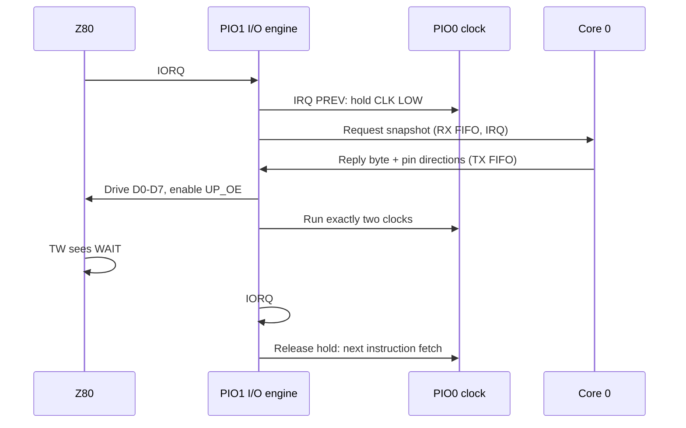

# CP/M execution, banked memory and PIO I/O

This page connects the CP/M memory map, PIO I/O engine and custom BIOS
for Phases 9 and 10. Start with the SVG overview, then use the detailed
[memory map](#cpm-memory-map-reference),
[PIO engine](#pio-io-engine-reference) and
[BIOS](#custom-bios-reference) reference sections below.
The Z80 runs CP/M and application code directly from SRAM. The Pico is
an I/O controller and boot supervisor, not a Z80 emulator.

## Two banks, one address window

[](../images/cpm-banked-memory.svg)

[Open or download the full-size memory-map SVG](../images/cpm-banked-memory.svg).
The regions are schematic, not proportional to their sizes. All diagram
addresses are hexadecimal; `#` on a signal name means active LOW.

The SRAM holds 128 KiB, arranged as two 64 KiB banks. The Z80 always sees
addresses `0000h`-`FFFFh`; A16 selects which bank occupies that window.
`OUT 07h` sends D0 to A16 through PIO1: zero selects bank 0, one selects
bank 1. It switches the whole window, not just application data.

| Bank | Application space | Resident responsibilities |
| --- | --- | --- |
| 0 | The Transient Program Area (TPA) is `0100h`-`E5FFh` (58,624 bytes total), shared by the `.COM` image, BSS, `malloc` heap and call stack. Program entry is `0100h`. | CCP command prompt, local console services, disk/file BDOS shim, BIOS and bank-switch gateway |
| 1 | The fixed-address DCC library region is `0100h`-`C7FFh` (50,944 bytes total), shared by the `.LIB` image, BSS, `malloc` heap and call stack. One library is loaded at a time; its header sets the call stack budget. | Separate 5,632-byte general allocation pool, resident library loader, allocator, authoritative BDOS, BIOS and gateway |

In both regions, **image** means code, the selected DCC runtime and initialized
data. The image, BSS, `malloc` heap and call stack share the region's total
capacity; that total is not free heap space.

**BSS (Block Started by Symbol)** is RAM reserved for zero-initialized global
and static variables in both bank-0 applications and bank-1 libraries.
For example, `static unsigned char buffer[1024];`
uses 1,024 BSS bytes. The loader clears BSS before the library runs, so the
`.LIB` file need not store those zeros. `heap_base` follows the image and BSS.

Bank 1 is not an extra 64 KiB of free heap. The library's `malloc` heap starts
after its image and BSS. Its last usable byte is `C800h - stack size - 1`;
`C800h - stack size` is the exclusive heap limit and the first stack address.
The call stack grows down from `C800h`. **Example: a 512-byte (`0200h`) call
stack** puts the heap's last byte at `C5FFh` and the stack at `C600h`-`C7FFh`.
This is not a fixed heap boundary: the `.LIB` header's configured call stack
budget determines it.

The diagram separates these three regions in both banks using
**512-byte call stack examples**:

| Region | Bank 0 TPA (inclusive) | Bank 1 library (inclusive) |
| --- | --- | --- |
| Image + BSS | `.COM`: `0100h` to `heap_base - 1` | `.LIB`: `0100h` to `heap_base - 1` |
| `malloc` heap | `heap_base` to `E3FFh` | `heap_base` to `C5FFh` |
| Call stack (512 bytes) | `E400h` to `E5FFh` | `C600h` to `C7FFh` |

The bank-0 example reserves the top 512 bytes of the TPA for a call stack
growing down from `E600h`; actual placement is application-specific, not a
fixed CP/M stack address. Bank 1 uses the `.LIB` header's stack budget below
`C800h`. `heap_base` is determined separately by each linked image and BSS,
so neither heap's size is fixed even in these examples.

The distinct `C800h`-`DDFFh` general pool is used through checked allocation
handles. Resetting that pool does not unload the library or reset its `malloc` heap.
The resident service region begins at `DE00h` and is not application memory.

### Why switching banks does not lose execution

The bank-switch gateway at `FF00h`-`FFFFh` has identical code in both banks.
The mirrored trampoline at `FB40h`-`FB7Fh` supports warm-boot return and
checked extent lookup. When the gateway changes A16, the next instruction
still comes from matching gateway code.

The gateway and resident service save the caller's stack and interrupt state,
use the appropriate bank-1 service or library stack, and restore bank 0
before returning. A bank-1 function never uses the bank-0 stack. Calls are
synchronous and non-reentrant; nested bank calls and interrupts/NMI during
a bank switch are unsupported.

Applications must not dereference pointers into the other bank or toggle
A16 around arbitrary C code. Use the BIOS/BANKSDK checked transfers and
generated library wrappers. The wrappers copy bounded arguments into a call
frame; bank-1 code receives local pointers to that copy, not bank-0 pointers.
The library service checks the typed export, module generation, pool epoch
and frame allocation before dispatch. Function results and transport status
are separate.

For exact addresses, ABI entry points and library budgets, see the
[memory map](#cpm-memory-map-reference),
[banked-memory BIOS extension](#banked-memory-bios-extension-abi-10)
and [library layout](../cpm-dcc/bank1-library-spec.md#library-memory-layout).

## From a CP/M call to physical I/O

[](../images/cpm-pio-execution.svg)

[Open or download the full-size execution-flow SVG](../images/cpm-pio-execution.svg).
The top row is Z80 software; the middle is Pico hardware and firmware.
Arrows represent call or data flow, not individual PCB wires.

### BDOS selects files; BIOS transfers records

1. A bank-0 application calls CP/M's BDOS vector at `0005h`, which jumps to
   the shim entry at `EE06h`.
2. Console operations stay local. Disk/file operations use the shim's private
   `F600h`-`F7FFh` stack and copy File Control Blocks (FCBs) and software
   DMA buffers through the gateway to the bank-1 BDOS proxy.
3. Bank 1's authoritative BDOS owns filenames, directories, allocation and
   record selection. A bank-1 library calls that BDOS through its own `0005h`
   vector. Host and library DMA/search continuations are separate, but the
   current drive, user and disk allocation state are shared.
4. BDOS calls the standard 17-entry BIOS jump table at `FC00h`.
   The BIOS implements console operations with ports `00h`-`01h` and disk
   operations with ports `10h`-`14h`.
5. PIO1 completes each emitted `IN` or `OUT`. Core 0 interprets the device
   request; core 1 performs queued transport and storage work.

For a disk request, the BIOS selects A-D and computes the linear record
address as `track * 32 + sector`. It writes the drive, address and command,
polls status, then uses `INIR` or `OTIR` to move one 128-byte record.
`SETDMA` sets a Z80 software buffer address; this path has no hardware DMA.
The BIOS keeps normal, directory and unallocated-write commands distinct.

The four onboard-flash disk slots are **512 KiB each**:
128 tracks x 32 records x 128 bytes = 524,288 bytes.
This is raw image capacity, not space available for files; system records,
directories and filesystem allocation consume part of it. No SD card is used.

### PIO owns timing; the ARM cores own services

| Owner | Role |
| --- | --- |
| HCT32 fixed logic | Asserts `WAIT#` when `IORQ#` falls, before software or PIO reacts |
| PIO0 clock state machine | Generates the configured 20 MHz Z80 clock from the 120 MHz system clock; holds it LOW when PIO1 requests an I/O hold |
| PIO1 I/O state machine | Detects cycles, samples or drives D0-D7, controls buffer enables, releases `WAIT#`, and completes `OUT 07h` bank selection |
| Core 0 | Drains PIO1 snapshots in bus order, applies device writes and provides read replies; handles boot and supervisor bus ownership outside normal cycles |
| Core 1 | Drains terminal queues to USB/WebSocket, supplies queued input, performs disk read-ahead and flash commits, and runs network/service workers |
| PIO2 | Reserved for the CYW43 Wi-Fi SPI driver; not part of the Z80 I/O engine |

PIO0 also shares its instruction memory with the OLED's DMA-fed I2C state
machine, which uses no PIO IRQ flags. PIO1 owns its block exclusively.
Core 0's per-cycle handler runs from Pico SRAM; it does not perform USB,
network operations or flash programming.

### OUT: sample, queue, resume

After hardware asserts `WAIT#`, PIO1 requests a LOW-phase clock hold and
samples the byte through the receive buffer. An ordinary OUT places a
snapshot in the four-word RX FIFO; `OUT 07h` instead changes A16 directly
without involving an ARM core. PIO releases `WAIT#` and resumes the clock,
then isolates the receive buffer and rearms for the next cycle.

Core 0 applies queued writes afterwards. If the FIFO is full, PIO keeps the
Z80 waiting rather than dropping a snapshot. FIFO order ensures that a later
IN observes every earlier queued OUT.

### IN: request, reply, sample, isolate

PIO1 queues the read snapshot and holds the clock LOW while waiting for
core 0's TX FIFO reply. It then places the byte on D0-D7, enables the
Pico-to-Z80 buffer and releases `WAIT#`.
Exactly two clocks run: the first lets the Z80 observe the wait release;
the second samples the byte at T3's falling edge. PIO holds CLK LOW again,
isolates the output buffer, returns the data GPIOs to inputs, and only then
resumes the next instruction fetch.

Ordinary SRAM reads and writes do not pass through this path. During normal
memory cycles, the Z80 drives the SRAM directly and the Pico's data paths
are isolated.

## Boot, warm boot and flash commits

- **Cold boot:** core 0 injects instructions under slow stepped clocks so
  the Z80 writes the 64 KiB bank-0 boot image into SRAM, then reads it back
  for verification. It also loads and verifies bank-1 page zero and
  `DE00h`-`FFFFh` (8,960 bytes total). The bank-1 library/pool range is
  initialized by its owners before use, not cleared wholesale at boot.
  PIO runtime I/O starts only after preparation and verification.
- **CP/M entry:** BIOS installs the `0000h` warm-boot and `0005h` BDOS
  vectors and enters the bank-0 CCP at `E600h`. `.COM` programs start at
  `0100h`.
- **Warm boot:** selects bank 0, flushes pending writes and reloads 44
  CCP/BDOS system records from Drive A. These records contain the bank-0
  shim, not the bank-1 authoritative BDOS, before returning to the prompt.
- **Runtime flash commit:** core 1 requests a safe programming window.
  Core 0 parks the Z80 with `BUSREQ#`/`BUSACK#`, drains queued I/O and pauses
  the engine before granting flash access. It rearms the engine and returns
  the bus afterwards. The Pico never takes over SRAM addresses or writes.

These diagrams describe ownership and sequencing, not timing qualification.
See [frequency qualification](../implementation/frequency-qualification.md)
for the hardware measurement requirements. Firmware, the boot package and
Drive A system records must agree on the resident layout and BIOS ABI.

## Maintained implementation

| Surface | Source |
| --- | --- |
| Memory layout and boot image | [build_images.py](https://github.com/gloveboxes/Z80ROMlessSBC/blob/main/src/cpm/build_images.py), [sram.c](https://github.com/gloveboxes/Z80ROMlessSBC/blob/main/src/common/sram.c) |
| BDOS forwarding and BIOS | [bank0_bdos_shim.asm](https://github.com/gloveboxes/Z80ROMlessSBC/blob/main/src/cpm/bank0_bdos_shim.asm), [z80_bios.asm](https://github.com/gloveboxes/Z80ROMlessSBC/blob/main/src/cpm/z80_bios.asm) |
| Mirrored gateway and library control | [banked_transfer.asm](https://github.com/gloveboxes/Z80ROMlessSBC/blob/main/src/common/banked_transfer.asm), [banked_extensions.asm](https://github.com/gloveboxes/Z80ROMlessSBC/blob/main/src/common/banked_extensions.asm) |
| PIO timing and ordered FIFO dispatch | [banked_io.pio](https://github.com/gloveboxes/Z80ROMlessSBC/blob/main/src/common/banked_io.pio), [banked_pio.c](https://github.com/gloveboxes/Z80ROMlessSBC/blob/main/src/common/banked_pio.c) |
| Disk geometry and backing storage | [flash_layout.h](https://github.com/gloveboxes/Z80ROMlessSBC/blob/main/src/common/include/z80sbc/flash_layout.h), [flash_backend.c](https://github.com/gloveboxes/Z80ROMlessSBC/blob/main/src/common/flash_backend.c) |

## CP/M memory map reference

The reset-ready SRAM image uses the following upper-memory layout:

| Region | Address range | Role |
| --- | --- | --- |
| Page zero | `0x0000`-`0x00FF` | CP/M vectors, default FCBs, DMA buffer, and command tail |
| Transient Program Area (TPA) | `0x0100`-`0xE5FF` | `.COM` image (code, DCC runtime, initialized data), BSS, `malloc` heap and call stack |
| CCP | `0xE600`-`0xEDFF` | Console Command Processor, reloaded after a warm boot |
| BDOS shim and tables | `0xEE00`-`0xFB3F` | Bank-0 console and disk/file proxy; entry at `0xEE06` |
| BDOS shim private stack | `0xF600`-`0xF7FF` | 512-byte stack inside the bank-0 BDOS slot; protects the CCP code below its small stack |
| Mirrored trampoline | `0xFB40`-`0xFB7F` | Bank-1 warm-boot return and checked-transfer extent lookup (`0xFB48`) |
| Reserved BDOS padding | `0xFB80`-`0xFBFF` | 128-byte BIOS directory buffer |
| BIOS core | `0xFC00`-`0xFEFD` | 766-byte Z80-optimized boot, console, disk, translation and startup-report routines |
| Spare padding | `0xFEFE`-`0xFEFF` | 2 bytes |
| BIOS bank extension | `0xFF00`-`0xFFFF` | READ/WRITE/INFO/HEAP entry points, mirrored code and private workspace |

The TPA contains `0xE500` bytes, or 58,624 bytes, before the CCP boundary. A
dcc program and every runtime block selected for it must fit in this space
together with its stack and heap. The CCP occupies `0x0800` bytes and the BDOS
slot occupies `0x0E00` bytes; the BDOS slot's final 128 bytes are reserved as
the BIOS directory buffer. The dcc runtime reads the installed
`JP 0xEE06` vector at `0x0005` to locate BDOS; application memory must still
remain below the CCP boundary at `0xE600`. Required CCP/BDOS workspace, the
allocation vectors, disk state, and internal stacks remain inside their
relocated resident regions.

The BIOS cold boot installs `JP` instructions at `0x0000` and `0x0005` for
warm boot and BDOS respectively. A dcc program normally starts at `0x0100` and
returns to CP/M through the warm-boot vector. The custom warm boot reloads
the 44 CCP/BDOS system records before returning to the command prompt,
restoring the resident image. The supported TPA above excludes the CCP.

The complete 1,024-byte `bios.bin` includes the core, two bytes of padding,
and the extension page. The [public BIOS API](#banked-memory-bios-extension-abi-10)
is installed in both SRAM banks. Production bank 0 contains a BDOS disk/file
shim in the `EE00h–FB3Fh` slot; the authoritative BDOS resides in bank 1.
The Drive A system tracks contain that shim for warm boot.

The bank-0 shim saves the caller's stack pointer and switches to its private
stack before forwarding disk calls. It restores the caller's stack before
returning. This keeps nested bank transfers away from the CCP instructions
immediately below the CCP stack.

| Bank-1 address | Role |
| --- | --- |
| `0000h–00FFh` | CP/M page zero |
| `0100h–(heap_base-1)` | Fixed `.LIB` image (code, DCC runtime, initialized data) and BSS |
| `heap_base–(C800h-stack-1)` | DCC library `malloc` heap, starting after linked BSS |
| `(C800h-stack)–C7FFh` | Pinned library stack; size comes from the `.LIB` header |
| `C800h–DDFFh` | General `bmalloc` pool, 5,632 bytes |
| `DE00h–E5FFh` | Resident loader, proxy and service workspace |
| `E600h–EDFFh` | Extent allocator metadata/code |
| `EE00h–FB3Fh` | Authoritative CP/M BDOS |
| `FB40h–FB7Fh` | Mirrored warm-boot return and extent lookup |
| `FB80h–FEFFh` | BIOS buffer and core |
| `FF00h–FFFFh` | Mirrored bank-switch gateway |

Boot loads and verifies bank-1 page zero and every byte from `DE00h` through
`FFFFh`. The `0100h–DDFFh` application, library stack, and shared heap range
is not cleared at boot; those regions are written by their owners before use.

Bank 0 cannot dereference bank-1 addresses. It uses the BIOS transfer calls
for parameter blocks and the library-control request for exported functions.
See the [library memory layout](../cpm-dcc/bank1-library-spec.md#library-memory-layout)
for the image, BSS, heap and stack rules. Firmware and the CP/M
system image must match when the bank-1 resident layout changes.

## PIO I/O engine reference

The Z80 executes CP/M directly from SRAM; only `IN` and `OUT` instructions
reach the Pico. In Phases 9 and 10 every one of those I/O cycles is completed
by the RP2350's PIO hardware. Core 0 never touches the bus during a cycle: it
only applies a written byte or supplies a byte to read. This section explains the
terms, what each PIO block does, and why this makes Z80 I/O fast.

### PIO terminology

| Term | Meaning |
| --- | --- |
| PIO block | A programmable I/O peripheral. The RP2350 has three: PIO0, PIO1 and PIO2. Each has 32 words of instruction memory shared by its state machines. |
| State machine (SM) | A tiny independent processor inside a block (four per block). It executes one PIO instruction per system clock: 8.33 ns at the 120 MHz supervisor clock, so its timing is exact and repeatable. |
| Scratch and shift registers | Each SM has X and Y scratch registers, an output shift register (OSR) for data going to pins, and an input shift register (ISR) for data read from pins. |
| Pin mappings | Each SM is configured with windows of GPIOs: `IN` reads from them, `OUT` and `SET` drive them, *side-set* drives a pin in the same instruction as other work, and `JMP PIN` branches on one pin. |
| FIFOs | Two four-word queues per SM. The SM *pushes* to the RX FIFO for the ARM cores to read; the ARM cores put words in the TX FIFO for the SM to *pull*. *Autopush* pushes the ISR automatically when it is full. |
| IRQ flags | Eight flags per block that SMs set, clear and wait on. They can interrupt an ARM core, and on the RP2350 `IRQ PREV` sets a flag in the neighbouring (previous) block. |

### The role of each PIO block

| Block | Program | Role |
| --- | --- | --- |
| PIO0 | `banked_clock`, 4 words | Generates the 20 MHz Z80 clock (3 ticks HIGH, 3 LOW) on GP2. It stops in a LOW phase whenever PIO0 IRQ flag 1 (I/O hold) or flag 2 (core-0 hold) is set. It shares PIO0 with the status OLED's I²C program. |
| PIO1 | `banked_io`, 29 words | The I/O engine. Claimed exclusively; it recognises, completes and times every Z80 `IN` and `OUT`, and drives the data bus, buffer enables, WAIT release and SRAM bank select (A16). |
| PIO2 | (not used by the Z80) | Left for the CYW43 Wi-Fi driver, whose SPI bus claims the highest free PIO block. |

PIO1's engine holds the Z80 clock through PIO0 with `IRQ PREV`, so the clock
and the I/O engine cooperate without any ARM involvement.

#### PIO1 pin windows

| Mapping | GPIOs | Signals |
| --- | --- | --- |
| `IN` | GP10 upwards | D0-D7, A0/A1/A2/A4, RD#, WR# |
| `OUT` (10 pins) | GP8-GP17 | A16 bank select, IO_RELEASE, D0-D7 |
| `SET` (2 pins) | GP6-GP7 | UP_OE# (Pico drives the Z80 bus), DOWN_OE# (Pico reads the Z80 bus) |
| Side-set | GP9 | IO_RELEASE: releases the hardware WAIT# |
| `JMP PIN` | GP27 | RD#: distinguishes `IN` from `OUT` |

The HCT32 asserts WAIT# in hardware as soon as IORQ# falls, so the Z80 is
already waiting before PIO sees the cycle.

### How PIO data reaches core 0

The I/O engine exchanges one 32-bit word per cycle with core 0 through its
FIFOs:

| Direction | Instruction | Word contents |
| --- | --- | --- |
| PIO1 → core 0 (RX) | `in pins, 32` with autopush | A snapshot of the pins: data in bits 0-7, A0/A1/A2/A4 in bits 8-11, RD# in bit 17, WR# in bit 18 |
| Core 0 → PIO1 (TX) | `pull`, `out pins, 10`, `out pindirs, 10` | The reply for an `IN`: pin levels for GP8-GP17 (A16 unchanged, IO_RELEASE LOW, D0-D7) in bits 0-9, then the pin directions to use while driving (bits 10-19) and when idle (bits 20-29) |

An RX-not-empty interrupt runs core 0's handler, which takes snapshots in bus
order: each OUT becomes a device write and each IN a device read whose byte
goes back in the TX FIFO (see [Division of work](#division-of-work)). The
handler and the device code it calls run from SRAM.

### An OUT cycle

1. IORQ# falls; PIO sets the I/O hold so the clock stops at its next LOW
   phase, and `JMP PIN` sees RD# HIGH.
2. PIO enables the receive buffer (DOWN_OE#) and lets it settle for eight
   ticks.
3. For port `07h` it drives D0 onto A16, switching the SRAM bank. For any
   other port it autopushes the snapshot to core 0.
4. It releases WAIT# while CLK is still LOW, clears the hold so the clock runs
   freely, waits for IORQ# to rise, then isolates the buffer and rearms WAIT#.

The Z80 continues as soon as PIO completes the cycle; core 0 applies the write
afterwards. If four writes are already queued, PIO waits before releasing
WAIT#, so the Z80 simply pauses rather than losing data.

### An IN cycle



After the reply arrives, PIO places the byte on D0-D7, enables the buffer
toward the Z80 and releases WAIT#. It then lets the clock run exactly two
cycles: in the first the Z80 sees WAIT# released, and at the falling edge of
the second (T3) it samples the data. PIO re-asserts the hold at precisely the
right instruction, so the clock stops in T3's LOW phase. Only after the bus is
isolated does the clock resume into the next opcode fetch, so the Pico can
never still be driving the bus when the Z80 reads its next instruction.

### Division of work

| Owner | Responsibility |
| --- | --- |
| PIO0 + PIO1 | All Z80 bus timing: the 20 MHz clock, cycle detection, buffer enables, data drive and sampling, WAIT# release and A16 bank select |
| Core 0 | The Z80's supervisor and the device logic behind its I/O ports |
| Core 1 | USB, Wi-Fi and network services, the web terminal, flash programming and the disk read-ahead |

#### Core 0: PIO1 interrupt

The RX-not-empty interrupt is core 0's only per-cycle work. It takes each
snapshot in bus order, applies OUT bytes and computes IN replies:

| Ports | Work |
| --- | --- |
| `00h-01h` console | Queue output to the shared ring for core 1 (USB or WebSocket), return input bytes, report status without taking the lock |
| `10h-14h` disk | Latch drive and LBA, run commands, serve reads from the SRAM read-ahead or flash, collect 128-byte write records and hand them to core 1 |
| `02h-04h` service ABI | Collect requests for core-1 workers and return their replies |
| `17h` timers | Countdown timers and stopwatches |
| `15h-16h` HTTP | Filename and chunk handshakes with the core-1 HTTP worker |
| `05h`, `06h` | Boot markers and disk-diagnostic results |
| `07h` (IN) | SRAM bank status; `OUT 07h` completes entirely in PIO |

Measured cost is about 1 µs per IN and 1.2-1.3 µs per OUT. Even at about
266,000 polled INs per second this is roughly a quarter of core 0's time
(excluding interrupt entry and exit), and most of it answers console-status
polls. Anything slow is handed to core 1 through bounded queues and
mailboxes.

#### Core 0: main loop

- **Flash grants.** When core 1 must program flash, core 0 parks the Z80 with
  BUSREQ#, applies queued OUTs and pauses the I/O engine. Afterwards it rearms
  the engine and returns the bus.
- **Watchdog.** A cycle that makes no progress for 500 ms holds the CPU in
  reset.
- **Supervisor commands** from core 1 (the **Ctrl-]** menu): load and verify,
  start, status (`[pio]`, `[iolat]`, `[disk]`), stop, reboot, fault arming,
  and configuration or web reboots.
- **Run monitoring.** BIOS and CCP boot markers, the boot timeout,
  disk-diagnostic progress, and holding the CPU on a fatal storage error.
- **Orderly stop.** Request a flush from core 1, park the Z80, apply queued
  OUTs and check disk quiescence, then hold RESET# or resume.
- **State publication** for core 1.

#### Core 0: boot

Before CP/M starts, core 0 recovers the flash journal, validates the boot
image and loads all 64 KiB into SRAM by injecting instructions on a slow,
software-stepped clock, then reads every byte back. It prepares bank 1 and
only then arms the I/O engine and starts the 20 MHz PIO clock. This loader is
the only use of stepped clocking.

Core 0 does no bus timing, clock stopping or stepping during a cycle, and no
USB, network or flash programming. Between cycles it is idle in its main
loop.

### Why it is fast

- **Hardware timing.** Every bus step is a PIO instruction with 8.33 ns
  resolution. There are no software delays, timer polls or clock stepping in
  the I/O path.
- **Core 0 does only the data work.** About 1 µs per IN in the measured
  workload, and an OUT never makes the Z80 wait for core 0 unless four writes
  are already queued.
- **High throughput.** Polled IN cycles run at about 225,000-266,000 per
  second on the 20 MHz Z80, which directly speeds up console polling, every
  `INIR` disk record transfer, and service and HTTP replies.
- **Bank switching at bus speed.** `OUT 07h` never involves an ARM core.
- **Isolated from Wi-Fi.** The handler runs from SRAM and does no network or
  flash work, so core-1 activity cannot stretch a Z80 I/O cycle.
- **Ordered and backpressured.** One FIFO preserves the Z80's bus order: an
  IN always observes every earlier OUT. A full FIFO holds WAIT# instead of
  dropping data.

**Ctrl-] s** reports the engine state (`[pio]`), core-0 cost per IN and OUT
(`[iolat]`) and disk read-ahead hits (`[disk]`).

### Safety

- Snapshots with neither or both of RD# and WR# active hold the CPU in reset
  through the watchdog.
- A cycle that makes no progress for 500 ms fails closed the same way.
- During a flash bus grant the board's pull-ups keep IORQ#, RD# and WR#
  inactive, and core 0 drains the FIFO before the grant and before a
  supervisor stop.

Source: [banked_io.pio](https://github.com/gloveboxes/Z80ROMlessSBC/blob/main/src/common/banked_io.pio)
(both PIO programs), [banked_pio.c](https://github.com/gloveboxes/Z80ROMlessSBC/blob/main/src/common/banked_pio.c)
(allocation, FIFO service) and [io_trap.c](https://github.com/gloveboxes/Z80ROMlessSBC/blob/main/src/common/io_trap.c)
(device dispatch). Hardware details: [PIO acceleration](../hardware/address-interface.md#pio-acceleration).

## Custom BIOS reference

The BIOS implements CP/M 2.2’s standard 17-entry jump table for BDOS and
dcc’s direct-BIOS functions.

| CP/M BIOS operation | Board implementation |
| --- | --- |
| `BOOT` | Initialize CP/M and page-zero vectors; enter CCP |
| `WBOOT` | Flush writes, reload CCP/BDOS from Drive A, and enter CCP |
| `CONST` | Return `0xFF` when terminal status port `0x01`, bit 0, reports input ready |
| `CONIN` | Wait for input on port `0x00`; return a 7-bit character |
| `CONOUT` | Wait for status bit 1 (transmit room); write C to port `0x00` |
| `READER` | Return text EOF (`0x1A`) |
| `LIST` / `PUNCH` | Discard output |
| `LISTST` | Return not ready |
| `HOME` | Set track to zero |
| `SELDSK` | Return the disk parameter header for A–D, or zero for an invalid drive |
| `SETTRK` / `SETSEC` / `SETDMA` | Store track, sector, and software buffer address; no hardware DMA |
| `READ` / `WRITE` | Transfer 128-byte records through ports `0x10`–`0x14`, preserving CP/M write-type semantics |
| `SECTRAN` | Return the sector unchanged; images use linear sector order |

BDOS handles filenames, FCBs, directories, allocation, and record selection.
The BIOS handles drives and records, so dcc file APIs need no custom backend.
See the [I/O port map](io-ports.md) for port decoding and aliases.

### Banked-memory BIOS extension (ABI 1.0)

The mirrored `FF00h` page is present in both banks. Check `BMX1` at `FF09h`,
major 1 at `FF0Dh`, minor 0 at `FF0Eh`, and INFO success before calling it.
Firmware and the CP/M system image must be updated together.

| Address | Entry | Contract |
| --- | --- | --- |
| `FF00h` | READ | HL=bank-0 buffer, DE=bank-1 address, BC=length |
| `FF03h` | WRITE | HL=bank-0 buffer, DE=bank-1 address, BC=length |
| `FF06h` | INFO | HL=`0100h`, DE=`C800h`, BC=`1600h` on success |
| `FF10h` | Service | E selects the operation below |

READ and WRITE use multiples of 16 bytes; both ranges must end at or below
the exclusive limit `FF00h` without wrapping.
Raw transfers into resident memory are for system code; application handles
are allocated only in `C800h–DDFFh`. The bank-0 C wrappers `bread` and `bwrite`
provide byte-granular transfers using discovered BIOS byte-copy helpers
(`F800h` READ, `F803h` WRITE). These helpers retain the register convention above, accept arbitrary
byte counts, and return A=0/carry clear or A=2/carry set for an invalid range.
Zero count succeeds without dereferencing either address. For positive counts,
the bank-0 buffer must start at or above `0100h`; the raw bank-1 address has
no equivalent lower-bound check and can include page zero. Both ranges must
end at or below `FF00h`, without wrapping. This does not make reserved bank-1
memory available to applications. Full-range validation precedes copying;
partial writes preserve neighbouring bytes.
IX/IY, stack and interrupt state are preserved.

`bread` and `bwrite` call the checked entries `F806h` READ and `F809h` WRITE.
They take A=handle page (a handle's high byte; handles are 256-byte aligned),
DE=bank-1 address, HL=bank-0 buffer and BC=byte count. The bank-0 shim maps
the page to its allocator extent: pool pages `C8h–DDh`, the pinned library at
page `01h` and its stack at `C0h`. With interrupts masked, the shim calls a
mirrored helper at `FB48h` that selects bank 1, reads the live extent length
and allocated marker, and reselects bank 0 without touching the stack. A
free, unused or unknown page returns A=3/carry set. A range starting below
the handle or ending beyond the extent returns A=2/carry set. Otherwise the
call continues as `F800h`/`F803h`. Every call checks the live tables, so a
handle freed or invalidated by RESET is rejected; no bounds are cached.

Counts divisible by 16 dispatch directly to the raw gateway, without setting up
tail storage. The gateway's 237-byte mirrored code retains the low count and
direction in A and saves the advancing source SP in that source bank's private
`FFF0h` word. Only D0 of bank-select OUT data is significant; the other bits may
contain the counter. Group bookkeeping happens once per 256 bytes, while each
16-byte burst still performs exactly two bank-select OUTs. The main carry flag
survives the register payload and avoids a second direction test. No allocation
metadata is cached. `FF06h` delegates to a bank-0-only INFO helper at `FA00h` inside the
BDOS shim. Deploy matching firmware, boot package and drive A system records together.
See [MEMPERF](https://github.com/gloveboxes/Z80ROMlessSBC/tree/main/examples/MEMPERF) for the repeated-workload
methodology and emulator cycle measurements, which exclude hardware wait time.

Resident allocator operations have a short dispatch path and save SP directly.
Metadata-table selectors preserve AF with bit operations; SIZE still validates
the current extent length and allocated marker on every call. Private host and
library context snapshots store nine bytes: the DMA word plus the actual search
state at `FB14h`, `FB18h–FB1Ah` and `FB29h–FB2Bh`. The host search proxy uses the
same packed seven-byte search layout. Adjacent shared disk-geometry scratch is
never copied as per-domain state.

#### Allocation and direct entry calls

| E | Operation | Arguments and result |
| --- | --- | --- |
| 0 | ALLOC | HL=requested bytes; returns a 256-byte-aligned handle or zero |
| 1 | FREE | HL=handle; returns 1 on success |
| 2 | SIZE | HL=handle; returns rounded size or zero |
| 3 | AVAILABLE | Returns free bytes, initially 5,632 |
| 4 | RESET | Invalidates general-pool handles and restores the free extent |
| 5 | CALL | HL=live code handle, BC=distinct live stack handle, IX=entry offset, IY=context; returns code's HL |
| 6 | BDOS proxy | Resident bank-0 BDOS shim service |
| 7 | CAPABILITIES | Returns bank-1 address of a 48-byte versioned descriptor, or zero |
| 8 | LIB CONTROL | HL=discovered request address; returns status independently of results |
| 9 | LAST STATUS | Returns last resident-service status without clearing it |

#### Capability and library control records

After INFO succeeds, use `bank_bios_query()` rather than inspecting allocator
signatures or private tables. The descriptor contains 24 little-endian words:

| Word | Meaning |
| --- | --- |
| 0-3 | Size (48), descriptor revision (1), ABI (`0100h`), feature mask (`003Fh`) |
| 4-7 | Pool start, capacity, allocation unit, raw burst size |
| 8-11 | Byte READ/WRITE entries, library request address and size |
| 12-15 | Export table address, image origin, pinned code and stack handles |
| 16-19 | Call-token address, maximum body bytes, exports and signature characters |
| 20-23 | Call revision (1), checked READ/WRITE entries, one reserved zero word |

Feature bits 0-5 advertise byte transfers, library control, detailed status,
DMA/search contexts, generation/epoch validation and checked handle transfers,
respectively.
`bank_bios_library_control()` copies the request to its discovered address,
dispatches operation 8 and retrieves the response. All fields are 16-bit words:

| Byte offset | Meaning |
| --- | --- |
| 0, 2 | Request size (32), revision (1) |
| 4, 6 | Action (0 LOAD, 1 INVALIDATE, 2 QUERY, 3 CALL), output status |
| 8, 10 | Expected/current module generation, zero-based export index |
| 12, 14 | Live FCB staging/frame handle, per-call token |
| 16, 18, 20 | Ready flag, export count, entry size |
| 22, 24, 26, 28 | Image bytes, export table address, image origin, stack handle |
| 30 | Expected/current pool epoch |

LOAD copies a padded 48-byte FCB from a live pool allocation. QUERY reports
authoritative descriptors without changing ownership. CALL requires a live
512-byte extent, a body length prefix in 1..256, a typed export and matching
module generation/pool epoch. INVALIDATE makes the module uncallable even at
generation exhaustion. Generations and epochs never wrap: further LOAD/RESET
fails with EXHAUSTED rather than reviving stale state.

BIOS status codes are:

| Code | Status | Meaning |
| --- | --- | --- |
| 0 | OK | The BIOS operation succeeded; an invoked function's result is separate. |
| 1 | UNAVAILABLE | The banked-memory capability or matching resident service is unavailable. |
| 2 | ARGUMENT | An argument, range, length, request field or operation is invalid. |
| 3 | HANDLE | A required allocation handle is not live or does not meet the operation's requirements. |
| 4 | MEMORY | No free extent can satisfy the allocation request. |
| 5 | PINNED | An attempt was made to free a pinned library or stack extent. |
| 6 | DISPATCH | A typed library adapter did not return its required success value of 1. |
| 7 | FORMAT | The library header is invalid. |
| 8 | IO | A library load encountered a file open or read failure. |
| 9 | STALE | The module is not ready, or the expected module generation or pool epoch does not match. |
| 10 | EXHAUSTED | A non-wrapping module-generation or pool-epoch counter cannot advance. |

Raw CALL returns arbitrary function HL, including valid zero;
status is separate. `bank_memory_last_error()` and `bank_bios_last_error()`
use the BIOS codes above. `bank_library_last_error()` uses the separate `BL_*`
codes defined in
[BANKLIB.H](https://github.com/gloveboxes/Z80ROMlessSBC/blob/main/examples/BANKSDK/BANKLIB.H);
for example, `BL_IO` is 2 and `BL_STALE` is 12.

`bmalloc` and `bfree` run in the bank-1 extent allocator. Free-list and
physical-extent tables occupy the pinned `E600h–EDFFh` region; returned
handles never point at metadata. Allocation searches free extents and splits
one; free coalesces adjacent extents. SIZE and AVAILABLE read tables directly.
`breset` preserves the pinned library, stack, loader and allocator.
Four compact 32-byte metadata tables preserve the entire 5,632-byte pool;
service growth does not reduce the library's DCC heap or stack.

The `0100h` library image and `C000h` stack are pinned handles for CALL.
For an ordinary allocated code block, the caller supplies its entry offset.
The BIOS validates the code and stack handles and offset; it cannot verify
that the offset is an instruction boundary. CALL places IY on the bank-1
stack as one 16-bit DCC C argument. A function using the normal DCC frame
prologue reads it at `IX+4` and returns a 16-bit value in HL.

#### Stack switch and return

1. The mirrored gateway saves the bank-0 interrupt state and selects bank 1.
2. Resident code saves the bank-0 SP in bank-1 workspace and uses its private
   service stack. CALL then switches to the exclusive end of the supplied,
   distinct live stack allocation and rejects `BC=0`.
3. The function returns with `RET`. Resident code restores SP, and the
   gateway selects bank 0, restores interrupt state and returns to C.

The bank-1 function never dereferences the bank-0 stack. IX and IY are
restored; HL carries the function result. Calls are sequential and cannot
re-enter the gateway from bank 1. Interrupt handlers and NMI during a bank
switch are unsupported.

DMA and search continuation belong separately to the host and library domains.
Only search fields are restored, not shared disk-geometry scratch variables.
Search Next refreshes the shared directory buffer before resuming; this adds
a directory read. Current drive/user and disk allocation state remain shared.

#### Bank-1 CP/M and C library

Bank 1 holds the authoritative BDOS and drive allocation state. The bank-0
BDOS disk/file shim forwards calls and marshals FCBs and DMA records. A bank-1
library may call its own BDOS for console and file I/O. Its DCC `malloc` heap
starts at the linked end of its image and BSS (`__hstart`); its exclusive upper limit
is `C800h` minus the configured stack size. The loader clears BSS and obtains
the heap base from the library header.
The fixed linked image begins at `0100h`; the separate general `bmalloc` pool
begins at `C800h`.

The bank-0 shim saves its caller's stack pointer, uses a private stack at
`F600h–F7FFh` while forwarding a call, then restores the caller's stack.
The CCP's own stack is too close to its code for nested bank transfers.

The resident LIB loader validates a `.LIB` header, reads the image into `0100h`,
initializes DCC heap bounds, and exposes export offsets. The bank-0 BANKLIB
runtime copies the length-prefixed call frame with `bank_bios_write()`, then
invokes LIB CONTROL (operation 8, action 3 CALL). The resident service
validates the module generation, pool epoch, frame allocation and typed export
before invoking CALL internally. After successful dispatch, BANKLIB reads
the result frame with `bank_bios_read()` and publishes it to the caller.
Direct CALL is available for lower-level code but does not replace the
typed library-control checks. The [bank-1 library design](../cpm-dcc/bank1-library-spec.md) describes
ownership and limits. [LIBDEMO](https://github.com/gloveboxes/Z80ROMlessSBC/tree/main/examples/LIBDEMO)
is the maintained C example; [SPREADS](https://github.com/gloveboxes/Z80ROMlessSBC/tree/main/examples/SPREADS)
shows the smaller hand-written-code path.

The example has two parts: the bank-0 host builds `DATATEST.COM`, and the
bank-1 library builds `DATA.LIB`. DCC generates the shared API header and
call wrappers from the library source. The host exercises scalar values,
copied buffers, flat records, file I/O, bank-owned blocks and library lifecycle.
Its [HOSTCHK.C](https://github.com/gloveboxes/Z80ROMlessSBC/blob/main/examples/LIBDEMO/host/HOSTCHK.C)
helper handles test setup, memory reports and cleanup checks.

??? example "Bank-0 host: LIBDEMO/host/DATATEST.C"

    ```c
    
    ```

??? example "Bank-1 library: LIBDEMO/lib/DATA.C"

    ```c
    
    ```

#### Boot and deployment

The Pico loads and verifies bank 0, then loads and verifies 8,960 bank-1
bytes, including the loader, allocator, BDOS, BIOS and mirrored gateway.
Bank-1 warm boot switches back to bank 0. Drive A's system tracks contain
the bank-0 BDOS shim, so warm boot restores the same gateway. Deploy matching
firmware, CP/M system image, and rebuilt `.COM` and `.LIB` files together.
Libraries carry format 1, ABI 1.0 and call revision 1 in their header.
